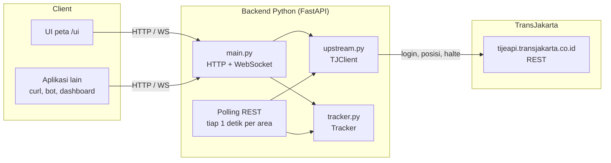

# Gambaran umum

## Untuk apa backend ini

App TransJakarta punya fitur peta yang menampilkan posisi bus secara live. Datanya hanya bisa diakses dari dalam app. Backend ini mengambil data yang sama dari server TransJakarta, lalu menyediakannya lewat API HTTP dan WebSocket yang sederhana. Dengan begitu aplikasi lain (web, bot, dashboard, skrip) bisa memakainya tanpa harus meniru app Android.

Singkatnya, client cukup bertanya "bus apa saja di sekitar titik ini?" dan backend yang mengurus sisanya: login ke server TransJakarta, mengambil posisi bus di area itu secara berkala, dan menyaring bus berdasarkan jarak.

## Gambaran arsitektur

## Komponen

| Komponen | File | Tugas |
|---|---|---|
| API | `app/main.py` | Endpoint HTTP dan WebSocket, validasi parameter, daftar area yang dipantau, polling REST, siklus hidup aplikasi |
| Client upstream | `app/upstream.py` | Semua request ke `tijeapi`: login, refresh token, posisi, halte, akun |
| Tracker | `app/tracker.py` | Cache posisi terakhir setiap bus (thread-safe) dan penyaringan per radius |
| Konfigurasi | `app/config.py` | Membaca variabel `TJ_*` dari environment atau `.env` |
| UI | `app/static/index.html` | Halaman peta yang memakai API di atas |

## Dari mana data posisi bus datang

Satu-satunya sumber adalah endpoint upstream `POST /v1/bus/offline`, yang mengembalikan posisi semua bus di sekitar sebuah titik. Backend memanggilnya untuk setiap area yang sedang dipantau:

- Area yang punya minimal satu client WebSocket di-polling terus setiap `TJ_POLL_SECONDS` (bawaan 1 detik). Client di area yang sama berbagi satu polling.
- `GET /buses` memicu polling saat itu juga kalau data area tersebut lebih tua dari `TJ_POLL_SECONDS`.

App asli juga bisa menerima posisi lewat MQTT, tapi broker-nya tidak bisa dihubungi dari jaringan pengembang, jadi jalur itu sudah dihapus dari backend ini. Field `source` di setiap bus menunjukkan asal datanya (`rest:/v1/bus/offline`).

## Apa saja yang disediakan

| Kebutuhan | Endpoint |
|---|---|
| Bus di sekitar titik, sekali ambil | `GET /buses` |
| Bus di sekitar titik, terus diperbarui | `WS /ws` |
| Detail satu bus | `GET /buses/{bus_body_no}` |
| Halte dan bus stop di sekitar | `GET /stops` |
| Data mentah posisi dari upstream | `GET /buses/offline` |
| Status server, login, dan polling | `GET /health` |
| Identitas login yang dipakai | `GET /account` |
| Riwayat perjalanan akun | `GET /account/trips` |
| Peta siap pakai | `GET /` → `/ui/` |
| Dokumentasi interaktif | `GET /docs` (Swagger), `GET /openapi.json` |

Detail setiap endpoint ada di [04-referensi-api.md](04-referensi-api.md).

## Prinsip desain

- **Satu polling per area.** Berapa pun client yang memantau area yang sama, backend hanya memanggil upstream sekali per interval untuk area itu, dengan satu token untuk semua.
- **Hanya polling area yang diminta.** Area berhenti di-polling begitu client WebSocket terakhirnya putus. Area yang hanya diminta lewat `GET /buses` dilupakan setelah 60 detik tanpa request.
- **Data disimpan di memori.** Tidak ada database. Posisi bus yang tidak diperbarui selama 5 menit dihapus. Akibatnya server harus berjalan dengan satu proses (lihat [11-pengembangan-lanjut.md](11-pengembangan-lanjut.md)).
- **Format upstream dipertahankan.** Field dari upstream tetap ada dengan nama yang sama. Backend hanya menambah field turunan seperti `next_stop_name` dan `distance_km`.
- **Rahasia tidak keluar.** Token dan password tidak pernah ditulis ke log dan tidak dikembalikan oleh endpoint mana pun.

## Teknologi

| Bagian | Pilihan | Versi |
|---|---|---|
| Bahasa | Python | 3.14 |
| Web framework | FastAPI + Starlette | 0.143.0 / 1.8.0 |
| Server ASGI | Uvicorn | 0.54.0 |
| HTTP client | httpx | 0.28.1 |
| Konfigurasi | pydantic-settings | 2.15.0 |
| Test | pytest | 9.1.1 |
| UI | Leaflet + OpenStreetMap (dari CDN) | 1.9.4 |
