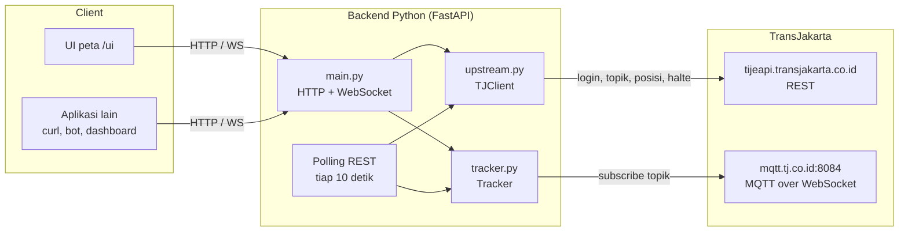

# Gambaran umum

## Untuk apa backend ini

App TransJakarta punya fitur peta yang menampilkan posisi bus secara live. Datanya hanya bisa diakses dari dalam app. Backend ini mengambil data yang sama dari server TransJakarta, lalu menyediakannya lewat API HTTP dan WebSocket yang sederhana. Dengan begitu aplikasi lain (web, bot, dashboard, skrip) bisa memakainya tanpa harus meniru app Android.

Singkatnya, client cukup bertanya "bus apa saja di sekitar titik ini?" dan backend yang mengurus sisanya: login ke server TransJakarta, memilih topik data yang tepat, mendengarkan update posisi, dan menyaring bus berdasarkan jarak.

## Gambaran arsitektur

## Komponen

| Komponen | File | Tugas |
|---|---|---|
| API | `app/main.py` | Endpoint HTTP dan WebSocket, validasi parameter, polling REST, siklus hidup aplikasi |
| Client upstream | `app/upstream.py` | Semua request ke `tijeapi`: login, refresh token, topik, posisi, halte, akun |
| Tracker | `app/tracker.py` | Satu koneksi MQTT, penyimpanan posisi terakhir setiap bus, penyaringan per radius, penyiaran update |
| Konfigurasi | `app/config.py` | Membaca variabel `TJ_*` dari environment atau `.env` |
| UI | `app/static/index.html` | Halaman peta yang memakai API di atas |

## Dari mana data posisi bus datang

Ada dua jalur, dan backend memakai yang tersedia.

1. **MQTT (realtime).** Ini jalur yang dipakai app asli. Backend minta daftar topik ke `POST /v1/bus`, lalu subscribe topik itu di broker `wss://mqtt.tj.co.id:8084/mqtt`. Setiap pesan berisi posisi satu bus.
2. **Polling REST (cadangan).** Endpoint `POST /v1/bus/offline` mengembalikan posisi semua bus di sekitar sebuah titik. Kalau broker MQTT tidak bisa dihubungi, backend memanggil endpoint ini tiap 10 detik untuk setiap area yang sedang dipantau client.

Saat dokumentasi ini ditulis, broker MQTT tidak bisa dihubungi dari jaringan pengembang (semua port timeout), jadi data yang tampil berasal dari jalur kedua. Client tidak perlu tahu perbedaannya. Format data dan endpoint-nya sama, dan field `topic` di setiap bus menunjukkan asalnya (`rest:/v1/bus/offline` atau nama topik MQTT).

## Apa saja yang disediakan

| Kebutuhan | Endpoint |
|---|---|
| Bus di sekitar titik, sekali ambil | `GET /buses` |
| Bus di sekitar titik, terus diperbarui | `WS /ws` |
| Detail satu bus | `GET /buses/{bus_body_no}` |
| Halte dan bus stop di sekitar | `GET /stops` |
| Data mentah posisi dari upstream | `GET /buses/offline` |
| Status server, login, dan MQTT | `GET /health` |
| Identitas login yang dipakai | `GET /account` |
| Riwayat perjalanan akun | `GET /account/trips` |
| Peta siap pakai | `GET /` → `/ui/` |
| Dokumentasi interaktif | `GET /docs` (Swagger), `GET /openapi.json` |

Detail setiap endpoint ada di [04-referensi-api.md](04-referensi-api.md).

## Prinsip desain

- **Satu koneksi ke upstream.** Berapa pun client yang tersambung, backend hanya membuka satu koneksi MQTT dan memakai satu token. Topik per area di-cache 60 detik.
- **Hanya polling area yang diminta.** Area yang tidak diminta client selama 10 menit berhenti di-polling dan topiknya di-unsubscribe.
- **Data disimpan di memori.** Tidak ada database. Posisi bus yang tidak diperbarui selama 5 menit dihapus. Akibatnya server harus berjalan dengan satu proses (lihat [11-pengembangan-lanjut.md](11-pengembangan-lanjut.md)).
- **Format upstream dipertahankan.** Field dari upstream tetap ada dengan nama yang sama. Backend hanya menambah field turunan seperti `next_stop_name` dan `distance_km`.
- **Rahasia tidak keluar.** Token dan password tidak pernah ditulis ke log dan tidak dikembalikan oleh endpoint mana pun.

## Teknologi

| Bagian | Pilihan | Versi |
|---|---|---|
| Bahasa | Python | 3.14 |
| Web framework | FastAPI + Starlette | 0.143.0 / 1.8.0 |
| Server ASGI | Uvicorn | 0.54.0 |
| HTTP client | httpx | 0.28.1 |
| MQTT client | paho-mqtt | 2.1.0 |
| Konfigurasi | pydantic-settings | 2.15.0 |
| Test | pytest | 9.1.1 |
| UI | Leaflet + OpenStreetMap (dari CDN) | 1.9.4 |
