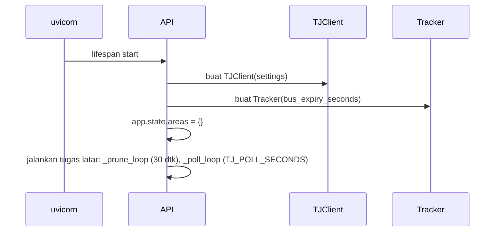
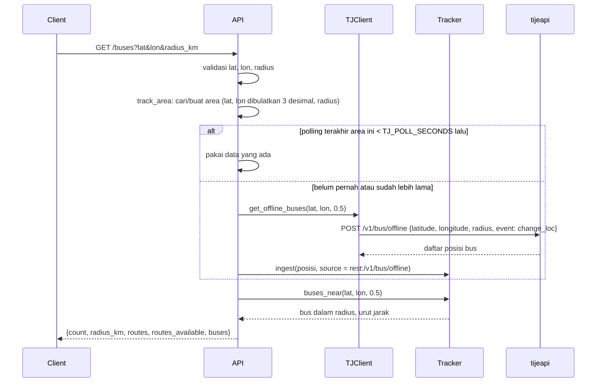
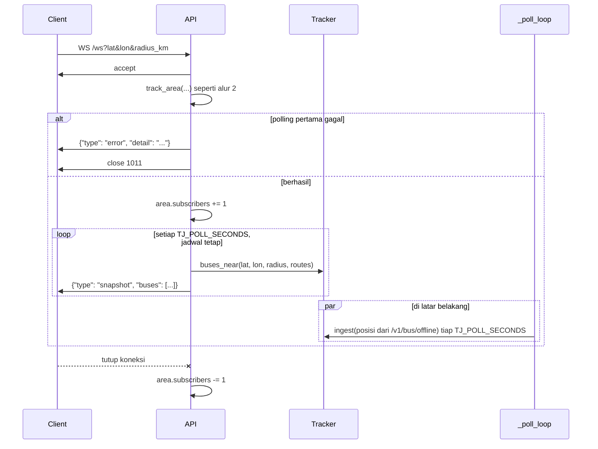
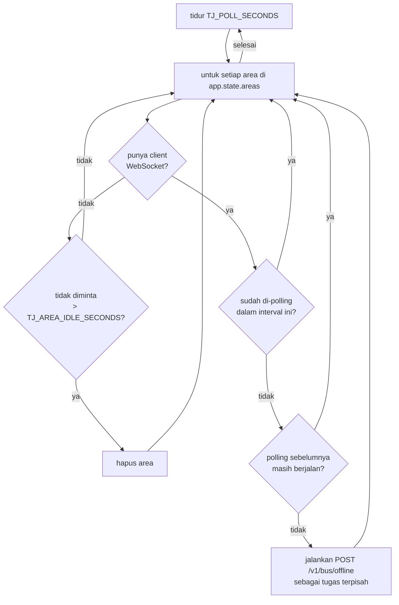
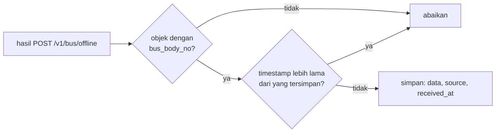
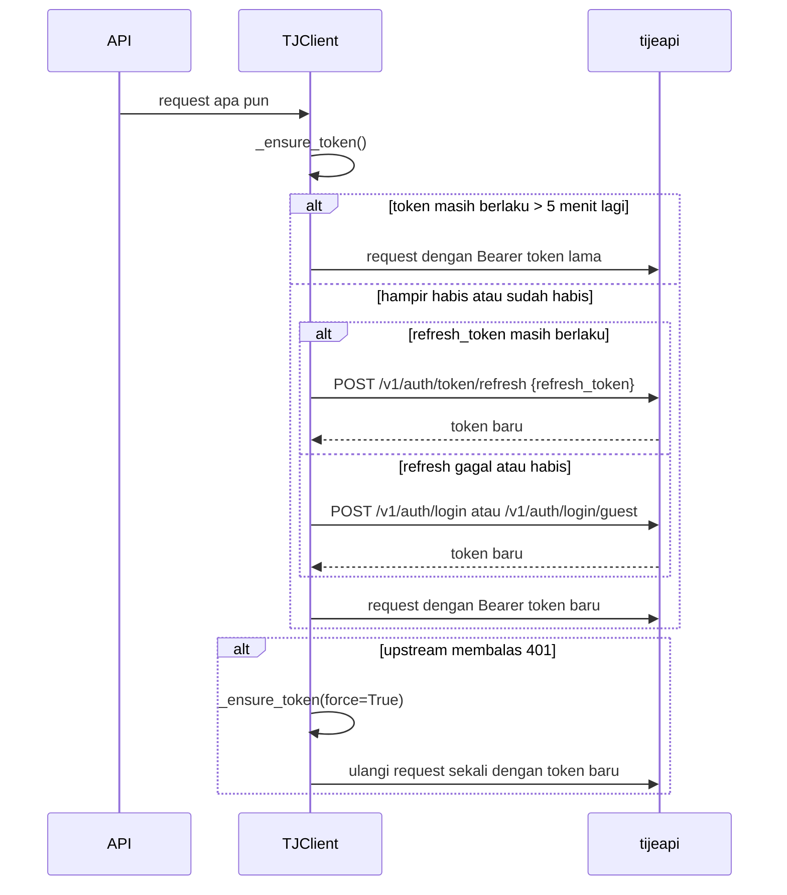

# Alur end to end

Halaman ini mengikuti data dari saat server dinyalakan sampai titik bus muncul di layar client. Setiap alur disertai diagram urutan dan contoh request yang benar-benar dikirim ke server TransJakarta.

Singkatan di diagram:

- **Client**: UI peta atau aplikasi lain yang memanggil backend.
- **API**: `app/main.py`.
- **TJClient**: `app/upstream.py`.
- **Tracker**: `app/tracker.py`.
- **tijeapi**: `https://tijeapi.transjakarta.co.id`.

## 1. Server dinyalakan



Saat startup backend belum menghubungi upstream sama sekali. Login terjadi pada request pertama yang butuh data dari `tijeapi` (lihat alur 2 dan 6), dan `_poll_loop` tidak melakukan apa pun selama belum ada area dengan client WebSocket.

## 2. Client meminta bus di sebuah area

Contoh: `GET /buses?lat=-6.1950&lon=106.8231&radius_km=0.5`.



Kalau polling pertama untuk area itu gagal, client menerima 502. Kalau area sudah pernah berhasil di-polling, kegagalan berikutnya hanya dicatat di log dan client menerima data terakhir yang ada.

Area yang hanya diminta lewat `GET /buses` disimpan di `app.state.areas`, tapi tidak di-polling di latar belakang. Area itu dihapus setelah `TJ_AREA_IDLE_SECONDS` (60 detik) tanpa request.

Kalau ini request pertama sejak server dinyalakan, TJClient login dulu sebagai guest (atau dengan akun, lihat [06-autentikasi-upstream.md](06-autentikasi-upstream.md)):

```http
POST /v1/auth/login/guest HTTP/1.1
Host: tijeapi.transjakarta.co.id
X-App-Version: 3.0.4
X-Device-ID: 9f2c41d07ab35e18
X-Lang: id
X-FCM-Token:
X-App-OS: android
X-App-OS-Version: 14
X-App-Platform: 34
X-Device-Model: Google|Pixel 8
Content-Type: application/json
Accept: application/json

{}
```

```json
{
  "user": {
    "email": "<disamarkan>",
    "phone": "",
    "name": "<disamarkan>",
    "avatar": "",
    "have_password": false,
    "is_verified": false,
    "is_guest": true,
    "id": 0
  },
  "token": "<disamarkan, 272 karakter>",
  "token_valid_until": 1791987416,
  "refresh_token": "<disamarkan, 272 karakter>",
  "refresh_token_valid_until": 1791991016,
  "moter": null
}
```

Lalu request posisi bus:

```http
POST /v1/bus/offline HTTP/1.1
Host: tijeapi.transjakarta.co.id
Authorization: Bearer <token>
Content-Type: application/json

{"latitude": -6.195, "longitude": 106.8231, "radius": 0.5, "event": "change_loc"}
```

```json
{
  "code": 200,
  "message": "success",
  "data": [
    {
      "bus_body_no": "MYS-17022",
      "route_code": "1",
      "route_name": "Kota",
      "route_color": "D62126",
      "latitude": -6.19545,
      "longitude": 106.823278,
      "speed": 0,
      "bearing": 217,
      "timestamp": "0",
      "trip_id": "1-R07",
      "direction": "",
      "distance": 0,
      "route_text_color": "FFFFFF",
      "type": "BRT",
      "stops": [],
      "trip_headsign": "Kota",
      "estimated_time_next_stops": 0,
      "estimated_distance_next_stops": 1626,
      "curr_stops": "",
      "next_stops": "H00278P-Harmoni",
      "prev_stops": "H00131P-Monumen Nasional",
      "livery": null
    },
    "... (19 item total)"
  ]
}
```

Tracker mengubah setiap item menjadi [objek bus](04-referensi-api.md#objek-bus), lalu `buses_near` menghitung jarak haversine ke titik pusat dan membuang yang di luar radius. Hasil akhirnya contoh response `GET /buses` di referensi API.

## 3. Client tersambung lewat WebSocket



Setiap koneksi WebSocket punya dua tugas: satu membaca dari client hanya untuk mengetahui kapan koneksi putus, satu lagi mengirim `snapshot`. Pengiriman memakai jadwal tetap (`next_at += poll_seconds`), jadi waktu yang dipakai untuk mengirim pesan besar tidak menggeser interval.

Pengiriman `snapshot` tidak menunggu polling. Handler hanya membaca isi Tracker, yang diperbarui oleh `_poll_loop` secara terpisah. Setiap client menyaring sendiri berdasarkan titik, radius, dan filter jalur miliknya, jadi client di Blok M tidak menerima bus di Kota.

## 4. Polling di latar belakang

Tugas `_poll_loop` berjalan terus di latar belakang:



Polling semua area yang jatuh tempo berjalan paralel. Area yang polling sebelumnya belum selesai (penanda `busy`) dilewati, jadi area yang lambat tidak menumpuk request dan tidak menunda area lain. Hasil polling masuk ke Tracker lewat `ingest`, dan sampai ke client lewat `snapshot` berikutnya.

Bebannya ke upstream: satu request per detik untuk setiap area yang punya client WebSocket (dengan `TJ_POLL_SECONDS=1`). Client yang memilih titik dan radius yang sama berbagi satu polling.

## 5. Bus diperbarui, kedaluwarsa, dan dibersihkan



Tugas `_prune_loop` berjalan setiap 30 detik dan menghapus bus dengan `received_at` lebih lama dari `TJ_BUS_EXPIRY_SECONDS` (300 detik). Bus yang keluar dari radius langsung hilang dari `snapshot` berikutnya karena `buses_near` menyaring ulang setiap kali, walaupun datanya masih tersimpan di Tracker sampai kedaluwarsa.

Data REST selalu ber-`timestamp` `"0"`. Karena aturan urutan hanya menolak data yang lebih lama, data baru dengan timestamp yang sama tetap diterima.

## 6. Token kedaluwarsa



Semua pengambilan token dikunci dengan `asyncio.Lock`, jadi beberapa request yang bersamaan tidak memicu login berkali-kali. Detail ada di [06-autentikasi-upstream.md](06-autentikasi-upstream.md).

## 7. Contoh lengkap dari sisi client

Urutan yang terjadi saat seseorang membuka UI peta dan mengklik dekat Bundaran HI:

1. Browser membuka `http://localhost:8000/`, diarahkan ke `/ui/`, lalu memuat Leaflet dari unpkg dan tile dari OpenStreetMap.
2. UI memanggil `GET /health` untuk menampilkan sumber data dan status login.
3. UI membuka `WS /ws?lat=-6.1754&lon=106.8272&radius_km=1` (titik awal Monas).
4. Pengguna mengklik peta. UI menutup WebSocket lama dan membuka `WS /ws?lat=-6.195&lon=106.8231&radius_km=1`.
5. Backend memanggil `POST /v1/bus/offline` untuk area baru, lalu mulai mengirim `snapshot`.
6. Setiap detik backend mem-polling area itu lagi dan mengirim `snapshot` baru. UI memindahkan marker yang berubah, menghapus marker bus yang tidak ada lagi di `snapshot`, dan mengurutkan ulang daftar.
7. Kalau pengguna menekan **Tampilkan halte**, UI memanggil `GET /stops` dan menggambar lingkaran halte.
8. Area lama (Monas) tidak punya client lagi, jadi berhenti di-polling dan dihapus setelah 60 detik. Bus yang tidak mendapat update selama 5 menit dihapus dari memori oleh backend.
