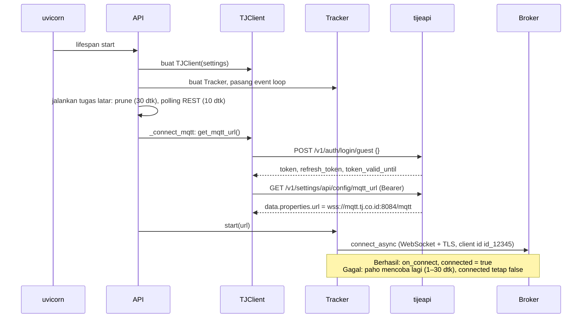
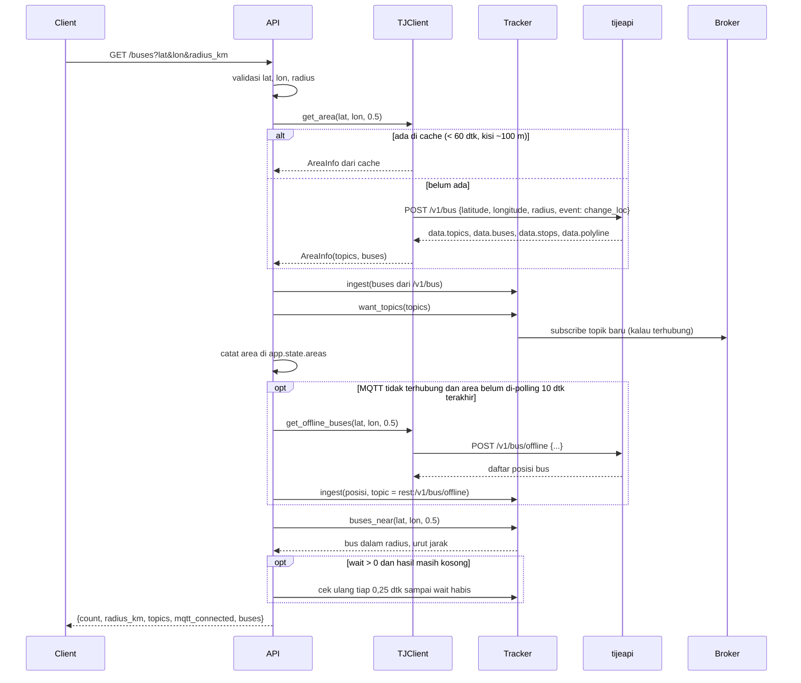
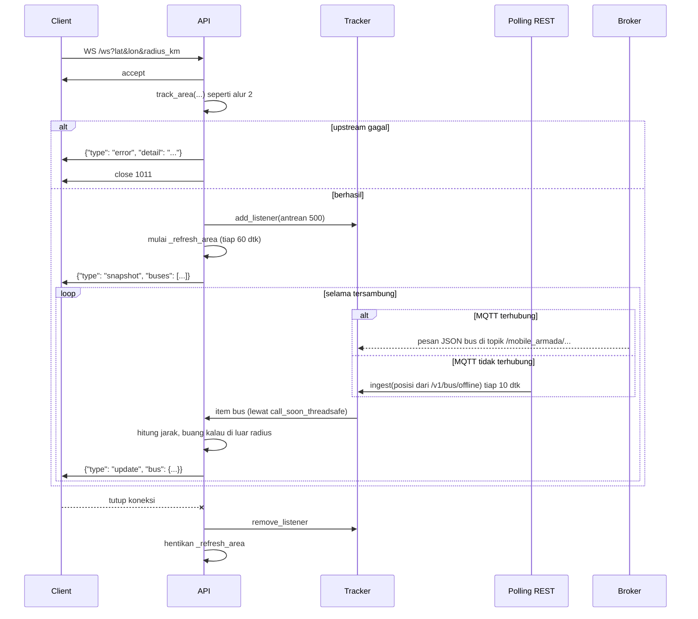
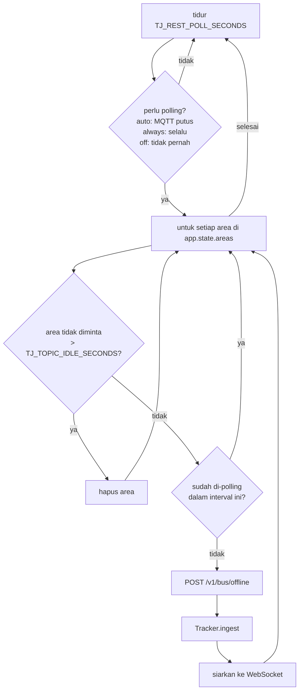
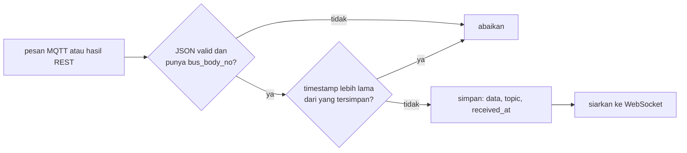
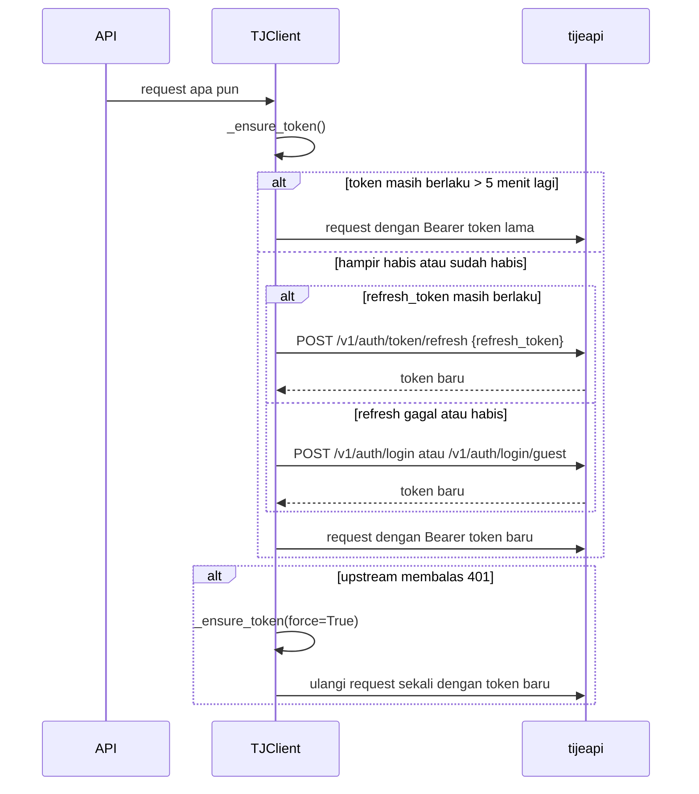

# Alur end to end

Halaman ini mengikuti data dari saat server dinyalakan sampai titik bus muncul di layar client. Setiap alur disertai diagram urutan dan contoh request yang benar-benar dikirim ke server TransJakarta.

Singkatan di diagram:

- **Client**: UI peta atau aplikasi lain yang memanggil backend.
- **API**: `app/main.py`.
- **TJClient**: `app/upstream.py`.
- **Tracker**: `app/tracker.py`.
- **tijeapi**: `https://tijeapi.transjakarta.co.id`.
- **Broker**: `wss://mqtt.tj.co.id:8084/mqtt`.

## 1. Server dinyalakan



Kalau langkah login atau `mqtt_url` gagal, `_connect_mqtt` mencoba lagi dengan jeda 5, 10, 20 detik dan seterusnya sampai paling lama 300 detik. Server tetap melayani request selama itu.

Request yang dikirim ke upstream pada tahap ini:

```http
POST /v1/auth/login/guest HTTP/1.1
Host: tijeapi.transjakarta.co.id
X-App-Version: 3.0.4
X-Device-ID: 9f2c41d07ab35e18
X-Lang: id
X-FCM-Token:
X-App-OS: android
X-App-OS-Version: 14
X-App-Platform: 34
X-Device-Model: Google|Pixel 8
Content-Type: application/json
Accept: application/json

{}
```

```json
{
  "user": {
    "email": "<disamarkan>",
    "phone": "",
    "name": "<disamarkan>",
    "avatar": "",
    "have_password": false,
    "is_verified": false,
    "is_guest": true,
    "id": 0
  },
  "token": "<disamarkan, 272 karakter>",
  "token_valid_until": 1791987416,
  "refresh_token": "<disamarkan, 272 karakter>",
  "refresh_token_valid_until": 1791991016,
  "moter": null
}
```

```http
GET /v1/settings/api/config/mqtt_url HTTP/1.1
Host: tijeapi.transjakarta.co.id
Authorization: Bearer <token>
X-App-Version: 3.0.4
...
```

```json
{
  "meta": { "code": 200, "status": "success", "message": "response.success" },
  "data": {
    "createdAt": "2025-10-16T04:25:32Z",
    "isActive": true,
    "name": "<tidak dicatat>",
    "properties": { "url": "wss://mqtt.tj.co.id:8084/mqtt" },
    "updatedAt": "2026-02-23T06:50:57Z"
  }
}
```

## 2. Client meminta bus di sebuah area untuk pertama kali

Contoh: `GET /buses?lat=-6.1950&lon=106.8231&radius_km=0.5`.



Request `POST /v1/bus` ke upstream dan response-nya:

```http
POST /v1/bus HTTP/1.1
Host: tijeapi.transjakarta.co.id
Authorization: Bearer <token>
Content-Type: application/json

{"latitude": -6.195, "longitude": 106.8231, "radius": 0.5, "event": "change_loc"}
```

```json
{
  "code": 200,
  "message": "success",
  "session_id": "",
  "data": {
    "buses": [],
    "session_id": "",
    "polyline": "xzud@s~|jS?o}@o}@?n}@??o}@o}@?~{B~{B?...",
    "stops": [],
    "topics": [
      "/mobile_armada/0016-0020/#",
      "/mobile_armada/0016-0021/#",
      "... (6 item total)"
    ]
  }
}
```

Topik berbentuk `/mobile_armada/<baris>-<kolom>/#`. Angka di tengah adalah sel kisi peta di sekitar titik. Tanda `#` adalah wildcard MQTT, artinya semua sub-topik di sel itu. `polyline` adalah kotak-kotak sel tersebut dalam format Google encoded polyline.

Request `POST /v1/bus/offline` memakai body yang sama. Response-nya berisi posisi bus:

```json
{
  "code": 200,
  "message": "success",
  "data": [
    {
      "bus_body_no": "MYS-17022",
      "route_code": "1",
      "route_name": "Kota",
      "route_color": "D62126",
      "latitude": -6.19545,
      "longitude": 106.823278,
      "speed": 0,
      "bearing": 217,
      "timestamp": "0",
      "trip_id": "1-R07",
      "direction": "",
      "distance": 0,
      "route_text_color": "FFFFFF",
      "type": "BRT",
      "stops": [],
      "trip_headsign": "Kota",
      "estimated_time_next_stops": 0,
      "estimated_distance_next_stops": 1626,
      "curr_stops": "",
      "next_stops": "H00278P-Harmoni",
      "prev_stops": "H00131P-Monumen Nasional",
      "livery": null
    },
    "... (19 item total)"
  ]
}
```

Tracker mengubah setiap item menjadi [objek bus](04-referensi-api.md#objek-bus), lalu `buses_near` menghitung jarak haversine ke titik pusat dan membuang yang di luar radius. Hasil akhirnya contoh response `GET /buses` di referensi API.

## 3. Client tersambung lewat WebSocket



Update disiarkan ke semua client WebSocket. Setiap handler menyaring sendiri berdasarkan titik dan radius miliknya, jadi client di Blok M tidak menerima bus di Kota.

## 4. Polling REST ketika MQTT tidak tersedia

Tugas `_rest_poll_loop` berjalan terus di latar belakang:



Dalam uji live selama sekitar 70 detik dengan satu client, upstream menerima 1 login guest, 1 `mqtt_url`, 2 `POST /v1/bus`, dan 6 `POST /v1/bus/offline`.

## 5. Bus diperbarui, kedaluwarsa, dan dibersihkan



Tugas `_prune_loop` berjalan setiap 30 detik:

- bus dengan `received_at` lebih lama dari `TJ_BUS_EXPIRY_SECONDS` (300 detik) dihapus;
- topik yang tidak diminta selama `TJ_TOPIC_IDLE_SECONDS` (600 detik) di-unsubscribe dari broker.

Data REST selalu ber-`timestamp` `"0"`. Karena aturan urutan hanya menolak data yang lebih lama, data REST tetap diterima selama bus itu belum mendapat data MQTT dengan timestamp asli.

## 6. Token kedaluwarsa



Semua pengambilan token dikunci dengan `asyncio.Lock`, jadi beberapa request yang bersamaan tidak memicu login berkali-kali. Detail ada di [06-autentikasi-upstream.md](06-autentikasi-upstream.md).

## 7. Contoh lengkap dari sisi client

Urutan yang terjadi saat seseorang membuka UI peta dan mengklik dekat Bundaran HI:

1. Browser membuka `http://localhost:8000/`, diarahkan ke `/ui/`, lalu memuat Leaflet dari unpkg dan tile dari OpenStreetMap.
2. UI memanggil `GET /health` untuk menampilkan sumber data dan status login.
3. UI membuka `WS /ws?lat=-6.1754&lon=106.8272&radius_km=1` (titik awal Monas).
4. Pengguna mengklik peta. UI menutup WebSocket lama dan membuka `WS /ws?lat=-6.195&lon=106.8231&radius_km=1`.
5. Backend memanggil `POST /v1/bus` dan `POST /v1/bus/offline` untuk area baru, lalu mengirim `snapshot`.
6. Setiap 10 detik backend mem-polling lagi dan mengirim `update` untuk bus yang bergerak. UI memindahkan marker dan mengurutkan ulang daftar.
7. Kalau pengguna menekan **Tampilkan halte**, UI memanggil `GET /stops` dan menggambar lingkaran halte.
8. Bus yang tidak mendapat update selama 5 menit dihapus dari peta oleh UI, dan dari memori oleh backend.
