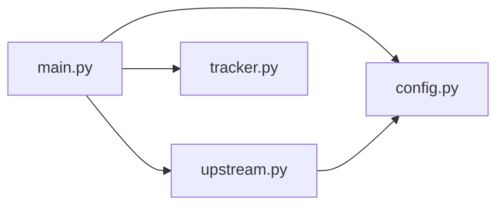

# Struktur kode

```
python/
├── .env.example          contoh konfigurasi
├── .gitignore            .venv, __pycache__, .pytest_cache, .env
├── README.md             ringkasan singkat
├── requirements.txt      dependensi dengan versi terkunci
├── app/
│   ├── __init__.py
│   ├── config.py         Settings (pydantic-settings)
│   ├── upstream.py       TJClient: semua request ke tijeapi
│   ├── tracker.py        Tracker: MQTT, penyimpanan bus, penyiaran
│   ├── main.py           FastAPI: endpoint, lifespan, tugas latar
│   └── static/
│       └── index.html    UI peta
├── docs/                 dokumentasi ini
└── tests/
    ├── __init__.py
    └── test_api.py       21 test, upstream dan MQTT palsu
```

Ketergantungan antar modul hanya satu arah:



`tracker.py` tidak tahu apa-apa tentang HTTP atau FastAPI, dan `upstream.py` tidak tahu apa-apa tentang MQTT. Keduanya bisa dites terpisah.

## `app/config.py`

Satu kelas, `Settings`, turunan `pydantic_settings.BaseSettings` dengan `env_prefix="TJ_"` dan `env_file=".env"`. Objek tunggal `settings` dibuat saat modul diimpor dan dipakai sebagai nilai bawaan di `create_app()`.

`device_id` bawaannya `uuid.uuid4().hex[:16]`, jadi nilainya berubah setiap proses baru kecuali diisi di `.env`.

Daftar semua field ada di [03-konfigurasi.md](03-konfigurasi.md).

## `app/upstream.py`

### `UpstreamError(Exception)`

Semua kegagalan bicara dengan upstream dibungkus menjadi exception ini: gagal jaringan, HTTP 4xx/5xx, atau response bukan JSON. Atribut `status` berisi kode HTTP kalau ada. Pesannya berbentuk `"<METHOD> <path>: HTTP <kode> <200 karakter pertama body>"`.

### `AreaInfo` (dataclass)

Hasil `POST /v1/bus` yang dipakai backend:

| Field | Tipe | Isi |
|---|---|---|
| `topics` | `list[str]` | `data.topics`, hanya string yang tidak kosong |
| `buses` | `list[dict]` | `data.buses`, hanya item berupa dict |

### `TJClient`

Dibuat sekali per aplikasi. Menyimpan satu `httpx.AsyncClient` dengan `base_url`, timeout, dan header identitas perangkat.

| Method | Upstream | Keterangan |
|---|---|---|
| `_headers()` | | Header `X-App-*`, `X-Device-*`, `Content-Type`, `Accept` |
| `auth_mode` (property) | | `static`, `user`, atau `guest` menurut konfigurasi |
| `token_info()` | | Isi `GET /account`, tanpa rahasia |
| `is_user_session` (property) | | `True` kalau token saat ini milik akun atau statis |
| `_store_tokens(body)` | | Ambil token dari response login/refresh (tingkat atas atau di `data`) |
| `_ensure_token(force=False)` | login / refresh | Pastikan ada token berlaku. Dikunci `_auth_lock` |
| `_send(method, url, headers=None, **kw)` | apa saja | Kirim tanpa urusan token, ubah error ke `UpstreamError` |
| `_request(method, url, **kw)` | apa saja | Kirim dengan Bearer token; ulang sekali setelah 401 |
| `request(method, url, **kw)` | apa saja | Versi publik `_request`, untuk endpoint akun tambahan |
| `get_mqtt_url()` | `GET /v1/settings/api/config/mqtt_url` | Kembalikan `data.properties.url` |
| `get_area(lat, lon, radius_km)` | `POST /v1/bus` | Cache 60 detik per kisi `round(lat, 3), round(lon, 3), radius` |
| `get_topics(lat, lon, radius_km)` | `POST /v1/bus` | Hanya `topics` dari `get_area` |
| `get_offline_buses(lat, lon, radius_km)` | `POST /v1/bus/offline` | Isi `data` apa adanya, tanpa cache |
| `get_bus_stops(lat, lon, radius_km)` | `GET /v2/bus-stop` | Isi `data` apa adanya, tanpa cache |
| `aclose()` | | Tutup koneksi HTTP |

Body yang dipakai `POST /v1/bus` dan `POST /v1/bus/offline` dibuat oleh `_area_payload()`:

```python
{"latitude": lat, "longitude": lon, "radius": radius_km, "event": "change_loc"}
```

Konstanta `TOKEN_MARGIN_SECONDS = 300` menentukan seberapa awal token diperbarui sebelum kedaluwarsa.

## `app/tracker.py`

### Fungsi bantu

| Fungsi | Keterangan |
|---|---|
| `haversine_km(lat1, lon1, lat2, lon2)` | Jarak lingkaran besar dalam km, jari-jari bumi 6371 km |
| `bus_position(bus)` | `(lat, lon)` dari `snap_*` kalau ada, kalau tidak dari `latitude`/`longitude`. `None` kalau tidak bisa dibaca |
| `stop_name(raw)` | `"H00251P-Tosari"` → `"Tosari"`. Hanya memotong kalau bagian depan berbentuk huruf lalu angka |
| `bus_type(raw)` | `BRT`, `Mikrotrans`, atau `Non-BRT` |
| `parse_routes(raw)` | `"4, 4d"` → `{"4", "4D"}`; kosong → `None` (tanpa filter) |
| `route_matches(bus, routes)` | `True` kalau tanpa filter atau `route_code` (huruf besar) ada di himpunan |
| `_num(v)` | Ubah ke float, 0 kalau gagal. Dipakai untuk membandingkan timestamp |
| `_put_nowait_drop_oldest(q, item)` | Masukkan ke antrean; kalau penuh, buang item tertua dulu |

### `Tracker`

Menyimpan keadaan bersama yang diakses dari dua thread: event loop asyncio (FastAPI) dan thread jaringan paho-mqtt. Semua akses ke struktur data dijaga `threading.Lock`.

| Atribut | Isi |
|---|---|
| `_buses` | `bus_body_no` → `{"data": dict upstream, "topic": str, "received_at": monotonic}` |
| `_topics` | topik → waktu terakhir diminta client |
| `_subscribed` | topik yang sudah di-subscribe ke broker |
| `_listeners` | antrean `asyncio.Queue` milik setiap client WebSocket |
| `_loop` | event loop tempat antrean berada |
| `connected` | status broker |
| `broker_url` | alamat broker |

| Method | Dipanggil dari | Keterangan |
|---|---|---|
| `attach_loop(loop)` | lifespan | Wajib dipanggil supaya update bisa disiarkan walau MQTT belum start |
| `start(url, loop)` | `_connect_mqtt` | Buat client paho (`websockets` atau `tcp`, TLS kalau `wss`/`mqtts`/`ssl`), `connect_async`, `loop_start` |
| `stop()` | lifespan | Hentikan loop paho dan putuskan koneksi |
| `_on_connect` | thread paho | Set `connected`, subscribe ulang semua topik yang diminati |
| `_on_disconnect` | thread paho | Set `connected = False` |
| `want_topics(topics)` | API | Tandai topik dibutuhkan sekarang, subscribe yang baru |
| `prune()` | `_prune_loop` | Hapus bus kedaluwarsa, unsubscribe topik menganggur |
| `handle_message(topic, payload)` | thread paho, test | Parse JSON (objek atau array), teruskan ke `ingest` |
| `ingest(items, topic)` | API, polling, `handle_message` | Simpan bus, tolak data yang lebih lama, siarkan hanya kalau datanya berubah |
| `_broadcast(item)` | `ingest` | `call_soon_threadsafe` ke setiap antrean |
| `add_listener(q)`, `remove_listener(q)` | `/ws` | Daftar dan lepas client WebSocket |
| `to_public(bus_body_no)` | API | Ubah data tersimpan menjadi [objek bus](04-referensi-api.md#objek-bus) |
| `buses_near(lat, lon, radius_km, routes=None)` | API | Semua bus dalam radius (dan jalur, kalau diberi), urut jarak, dengan `distance_km` |
| `stats()` | `/health` | Ringkasan jumlah dan status |

## `app/main.py`

### `create_app(settings, client=None, tracker=None, start_mqtt=True)`

Pabrik aplikasi. Parameter `client`, `tracker`, dan `start_mqtt` memungkinkan test menyuntikkan upstream palsu tanpa jaringan. Objek `app` di bagian bawah file dibuat dengan nilai bawaan dan itulah yang dijalankan uvicorn (`app.main:app`).

Isi `lifespan`:

1. `app.state.client`: `TJClient`.
2. `app.state.tracker`: `Tracker`, lalu `attach_loop`.
3. `app.state.areas`: dict area yang sedang dipantau. Kunci `(round(lat, 3), round(lon, 3), radius)`, nilai `{"lat", "lon", "r", "last", "polled"}`.
4. Tugas latar: `_prune_loop`, `_rest_poll_loop` (kecuali `TJ_REST_POLL=off`), `_connect_mqtt` (kecuali `start_mqtt=False`).
5. Saat berhenti: batalkan tugas, `tracker.stop()`, `client.aclose()`.

### Fungsi di dalam `create_app`

| Fungsi | Keterangan |
|---|---|
| `radius_param(radius_km)` | Kosong → `TJ_DEFAULT_RADIUS_KM`, lalu potong ke `TJ_MAX_RADIUS_KM` |
| `track_area(app, lat, lon, r)` | Inti setiap request area: `get_area`, `ingest`, `want_topics`, catat area, polling pertama kalau perlu. `UpstreamError` menjadi HTTP 502 |

### Fungsi tingkat modul

| Fungsi | Keterangan |
|---|---|
| `route_summary(buses)` | Daftar `{route_code, route_color, route_text_color, count}` untuk `routes_available`, urut alami (1, 1A, 2, 4, 4D, 10, JAK.10) |
| `_connect_mqtt(app, settings)` | Dapatkan URL broker (konfigurasi atau upstream), coba lagi dengan jeda 5 → 300 detik, lalu `tracker.start` |
| `_should_poll(app, settings)` | `always` → ya; `auto` → ya kalau MQTT tidak terhubung; `off` → tidak |
| `_poll_area(app, entry)` | `get_offline_buses` lalu `ingest`. Error hanya ditulis ke log |
| `_rest_poll_loop(app, settings)` | Setiap `TJ_REST_POLL_SECONDS`: hapus area menganggur, polling area lain |
| `_prune_loop(tracker)` | Setiap 30 detik: `tracker.prune()` |
| `_refresh_area(app, lat, lon, r, every)` | Per client WebSocket: perbarui topik area setiap `TJ_TOPICS_CACHE_SECONDS` |

### Konstanta

| Nama | Nilai | Keterangan |
|---|---|---|
| `LAT` | `ge=-7.5, le=-5.5` | Batas lintang parameter |
| `LON` | `ge=106.0, le=107.5` | Batas bujur parameter |

## Konkurensi

- FastAPI dan semua tugas latar berjalan di satu event loop asyncio.
- paho-mqtt memakai thread sendiri (`loop_start`). Callback-nya (`_on_connect`, `handle_message`) berjalan di thread itu.
- Data bersama di `Tracker` dijaga `threading.Lock`. Antrean asyncio hanya diisi lewat `loop.call_soon_threadsafe`, jadi aman diisi dari thread paho.
- `TJClient` hanya dipakai dari event loop. Login dan refresh dikunci `asyncio.Lock` (`_auth_lock`), cache topik dikunci `asyncio.Lock` (`_lock`).

## Logging

Format: `%(asctime)s %(levelname)s %(name)s: %(message)s`, level INFO.

| Logger | Contoh pesan |
|---|---|
| `httpx` | `HTTP Request: POST https://tijeapi.transjakarta.co.id/v1/bus "HTTP/1.1 200 OK"` |
| `app.upstream` | `logged in as guest, token valid until 1791982427` |
| `app.upstream` | `account login failed: ...; falling back to guest` (ERROR) |
| `tj` | `MQTT broker: wss://mqtt.tj.co.id:8084/mqtt` |
| `tj` | `REST poll failed: ...` (WARNING) |
| `app.tracker` | `MQTT connect wss://...: Success`, `MQTT disconnected: ...` |

URL di log `httpx` bisa berisi koordinat (query string `/v2/bus-stop`). Token dan password tidak pernah muncul.
