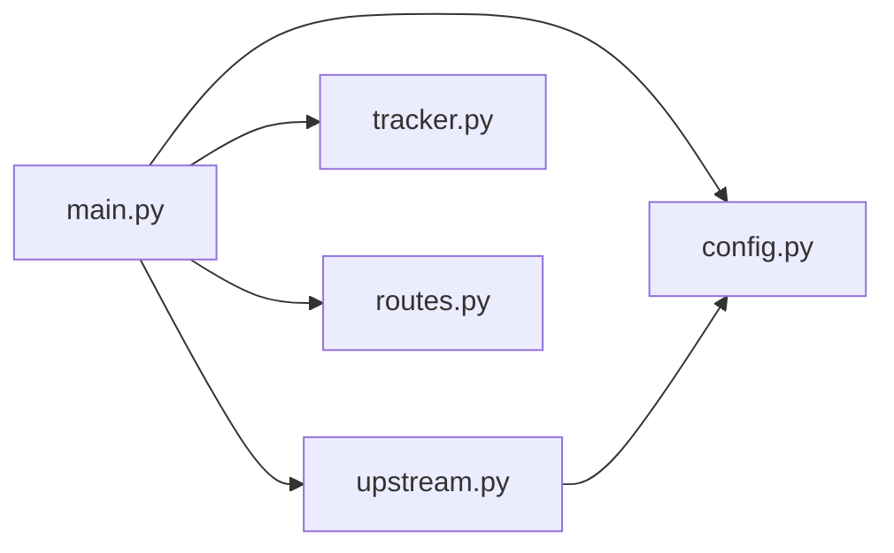

# Struktur kode

```
python/
├── .env.example          contoh konfigurasi
├── .gitignore            .venv, __pycache__, .pytest_cache, .env
├── README.md             ringkasan singkat
├── requirements.txt      dependensi dengan versi terkunci
├── app/
│   ├── __init__.py
│   ├── config.py         Settings (pydantic-settings)
│   ├── upstream.py       TJClient: semua request ke tijeapi
│   ├── tracker.py        Tracker: cache posisi bus, penyaringan radius
│   ├── routes.py         decode polyline, ringkas data rute
│   ├── main.py           FastAPI: endpoint, area, polling, lifespan
│   └── static/
│       └── index.html    UI peta
├── docs/                 dokumentasi ini
└── tests/
    ├── __init__.py
    └── test_api.py       24 test, upstream palsu
```

Ketergantungan antar modul hanya satu arah:



`tracker.py` tidak tahu apa-apa tentang HTTP, FastAPI, atau upstream; ia hanya menyimpan dan menyaring posisi. `upstream.py` tidak tahu apa-apa tentang area atau Tracker. Keduanya bisa dites terpisah.

## `app/config.py`

Satu kelas, `Settings`, turunan `pydantic_settings.BaseSettings` dengan `env_prefix="TJ_"` dan `env_file=".env"`. Objek tunggal `settings` dibuat saat modul diimpor dan dipakai sebagai nilai bawaan di `create_app()`.

`device_id` bawaannya `uuid.uuid4().hex[:16]`, jadi nilainya berubah setiap proses baru kecuali diisi di `.env`.

Daftar semua field ada di [03-konfigurasi.md](03-konfigurasi.md).

## `app/upstream.py`

### `UpstreamError(Exception)`

Semua kegagalan bicara dengan upstream dibungkus menjadi exception ini: gagal jaringan, HTTP 4xx/5xx, atau response bukan JSON. Atribut `status` berisi kode HTTP kalau ada. Pesannya berbentuk `"<METHOD> <path>: HTTP <kode> <200 karakter pertama body>"`.

### `TJClient`

Dibuat sekali per aplikasi. Menyimpan satu `httpx.AsyncClient` dengan `base_url`, timeout, dan header identitas perangkat.

| Method | Upstream | Keterangan |
|---|---|---|
| `_headers()` | | Header `X-App-*`, `X-Device-*`, `Content-Type`, `Accept` |
| `auth_mode` (property) | | `static`, `user`, atau `guest` menurut konfigurasi |
| `token_info()` | | Isi `GET /account`, tanpa rahasia |
| `is_user_session` (property) | | `True` kalau token saat ini milik akun atau statis |
| `_store_tokens(body)` | | Ambil token dari response login/refresh (tingkat atas atau di `data`) |
| `_ensure_token(force=False)` | login / refresh | Pastikan ada token berlaku. Dikunci `_auth_lock` |
| `_send(method, url, headers=None, **kw)` | apa saja | Kirim tanpa urusan token, ubah error ke `UpstreamError` |
| `_request(method, url, **kw)` | apa saja | Kirim dengan Bearer token; ulang sekali setelah 401 |
| `request(method, url, **kw)` | apa saja | Versi publik `_request`, untuk endpoint akun tambahan |
| `get_offline_buses(lat, lon, radius_km)` | `POST /v1/bus/offline` | Isi `data` apa adanya, tanpa cache |
| `get_bus_stops(lat, lon, radius_km)` | `GET /v2/bus-stop` | Isi `data` apa adanya, tanpa cache |
| `aclose()` | | Tutup koneksi HTTP |

Body `POST /v1/bus/offline` dibuat oleh `_area_payload()`:

```python
{"latitude": lat, "longitude": lon, "radius": radius_km, "event": "change_loc"}
```

Konstanta `TOKEN_MARGIN_SECONDS = 300` menentukan seberapa awal token diperbarui sebelum kedaluwarsa.

## `app/tracker.py`

### Fungsi bantu

| Fungsi | Keterangan |
|---|---|
| `haversine_km(lat1, lon1, lat2, lon2)` | Jarak lingkaran besar dalam km, jari-jari bumi 6371 km |
| `bus_position(bus)` | `(lat, lon)` dari `snap_*` kalau ada, kalau tidak dari `latitude`/`longitude`. `None` kalau tidak bisa dibaca |
| `stop_name(raw)` | `"H00251P-Tosari"` → `"Tosari"`. Hanya memotong kalau bagian depan berbentuk huruf lalu angka |
| `bus_type(raw)` | `BRT`, `Mikrotrans`, atau `Non-BRT` |
| `parse_routes(raw)` | `"4, 4d"` → `{"4", "4D"}`; kosong → `None` (tanpa filter) |
| `route_matches(bus, routes)` | `True` kalau tanpa filter atau `route_code` (huruf besar) ada di himpunan |
| `_num(v)` | Ubah ke float, 0 kalau gagal. Dipakai untuk membandingkan timestamp |

### `Tracker`

Cache posisi terakhir setiap bus. Tidak punya koneksi, antrean, atau listener: ia hanya diisi oleh polling dan dibaca oleh endpoint. Semua akses ke `_buses` dijaga `threading.Lock`, jadi aman dipanggil dari mana saja (termasuk dari test tanpa event loop).

| Atribut | Isi |
|---|---|
| `bus_expiry_seconds` | Umur maksimal data bus sebelum dihapus `prune()` |
| `_buses` | `bus_body_no` → `{"data": dict upstream, "source": str, "received_at": monotonic}` |

| Method | Dipanggil dari | Keterangan |
|---|---|---|
| `Tracker(bus_expiry_seconds)` | lifespan, test | Buat cache kosong |
| `ingest(items, source)` | `_poll_area`, test | Simpan setiap dict yang punya `bus_body_no`. Data dengan `timestamp` lebih lama dari yang tersimpan diabaikan |
| `prune()` | `_prune_loop` | Hapus bus yang tidak diperbarui selama `bus_expiry_seconds` |
| `to_public(bus_body_no)` | API | Ubah data tersimpan menjadi [objek bus](04-referensi-api.md#objek-bus) |
| `buses_near(lat, lon, radius_km, routes=None)` | `/buses`, `/ws` | Semua bus dalam radius (dan jalur, kalau diberi), urut jarak, dengan `distance_km` |
| `stats()` | `/health` | `{"buses": jumlah bus tersimpan}` |

## `app/routes.py`

| Fungsi | Keterangan |
|---|---|
| `decode_polyline(encoded, precision=5)` | Google encoded polyline → `[[lat, lon], ...]`. Input yang terpotong menghasilkan titik yang sempat terbaca |
| `normalize_route(route_code, data)` | `data` dari `GET /v2/route/{code}` → bentuk respons `GET /routes/{route_code}`. Arah yang `null` dilewati; arah tanpa polyline memakai garis lurus antarhalte |

## `app/main.py`

### `create_app(settings, client=None, tracker=None)`

Pabrik aplikasi. Parameter `client` dan `tracker` memungkinkan test menyuntikkan upstream palsu tanpa jaringan. Objek `app` di bagian bawah file dibuat dengan nilai bawaan dan itulah yang dijalankan uvicorn (`app.main:app`).

Isi `lifespan`:

1. `app.state.client`: `TJClient`.
2. `app.state.tracker`: `Tracker(bus_expiry_seconds)`.
3. `app.state.areas`: dict area yang sedang dipantau. Kunci `(round(lat, 3), round(lon, 3), radius)`, nilai `{"lat", "lon", "r", "last", "polled", "subscribers", "busy"}`:
   - `last`: kapan terakhir diminta (`/buses`) atau dikirimi `snapshot` (`/ws`), dipakai untuk menghapus area menganggur;
   - `polled`: kapan polling terakhir berhasil, `0.0` kalau belum pernah;
   - `subscribers`: jumlah client WebSocket di area ini;
   - `busy`: `True` selama polling area ini sedang berjalan.
4. Tugas latar: `_prune_loop` dan `_poll_loop`.
5. Saat berhenti: batalkan tugas, `client.aclose()`.

### Fungsi di dalam `create_app`

| Fungsi | Keterangan |
|---|---|
| `radius_param(radius_km)` | Kosong → `TJ_DEFAULT_RADIUS_KM`, lalu potong ke `TJ_MAX_RADIUS_KM` |
| `track_area(app, lat, lon, r)` | Inti setiap request area: cari atau buat area, perbarui `last`, lalu polling sekarang kalau `polled` lebih tua dari `TJ_POLL_SECONDS`. `UpstreamError` pada polling pertama menjadi HTTP 502; setelah itu hanya ditulis ke log |

### Fungsi tingkat modul

| Fungsi | Keterangan |
|---|---|
| `route_summary(buses)` | Daftar `{route_code, route_color, route_text_color, count}` untuk `routes_available`, urut alami (1, 1A, 2, 4, 4D, 10, JAK.10) |
| `_poll_area(app, entry)` | `get_offline_buses` lalu `ingest` dengan sumber `rest:/v1/bus/offline`. Langsung kembali kalau area sedang `busy`. `UpstreamError` diteruskan ke pemanggil |
| `_poll_quietly(app, entry)` | `_poll_area`, tapi error hanya ditulis ke log. Dipakai `_poll_loop` |
| `_poll_loop(app, settings)` | Setiap `TJ_POLL_SECONDS`: polling paralel area yang punya client WebSocket (kecuali yang masih `busy`), hapus area tanpa client yang menganggur lebih dari `TJ_AREA_IDLE_SECONDS` |
| `_prune_loop(tracker)` | Setiap 30 detik: `tracker.prune()` |

Handler `/ws` sendiri menjalankan dua tugas per koneksi: `read()` yang hanya menunggu client putus, dan `send()` yang mengirim `snapshot` dengan jadwal tetap setiap `TJ_POLL_SECONDS`. Begitu salah satunya selesai, keduanya dibatalkan dan `subscribers` area dikurangi.

### Konstanta

| Nama | Nilai | Keterangan |
|---|---|---|
| `LAT` | `ge=-7.5, le=-5.5` | Batas lintang parameter |
| `LON` | `ge=106.0, le=107.5` | Batas bujur parameter |

## Konkurensi

- FastAPI dan semua tugas latar berjalan di satu event loop asyncio. Tidak ada thread tambahan.
- Polling beberapa area berjalan sebagai tugas asyncio terpisah, jadi area yang lambat tidak menahan area lain. Penanda `busy` per area mencegah dua polling area yang sama berjalan bersamaan.
- Data di `Tracker` tetap dijaga `threading.Lock`, sehingga aman dipakai juga di luar event loop (misalnya dari test).
- `TJClient` hanya dipakai dari event loop. Login dan refresh dikunci `asyncio.Lock` (`_auth_lock`).

## Logging

Format: `%(asctime)s %(levelname)s %(name)s: %(message)s`, level INFO.

| Logger | Contoh pesan |
|---|---|
| `httpx` | `HTTP Request: POST https://tijeapi.transjakarta.co.id/v1/bus/offline "HTTP/1.1 200 OK"` |
| `app.upstream` | `logged in as guest, token valid until 1791982427` |
| `app.upstream` | `account login failed: ...; falling back to guest` (ERROR) |
| `tj` | `poll failed: ...` (WARNING) |

URL di log `httpx` bisa berisi koordinat (query string `/v2/bus-stop`). Token dan password tidak pernah muncul.
