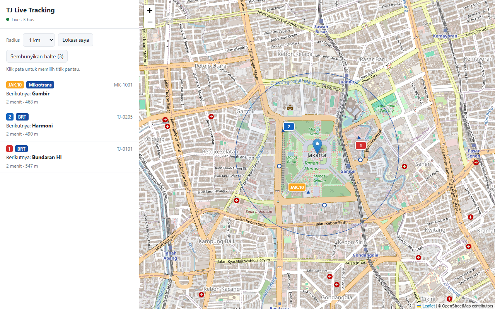
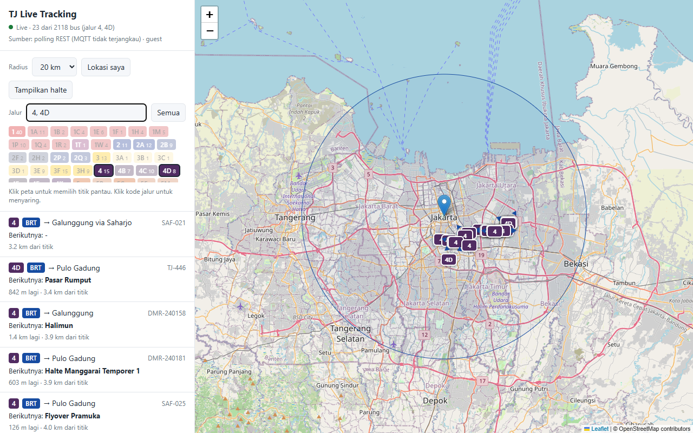

# UI peta

`app/static/index.html` adalah satu file HTML berisi CSS dan JavaScript. Tidak ada proses build. Backend menyajikannya di `/ui/`, dan `/` diarahkan ke sana.



*Tangkapan layar di atas memakai server demo dengan tiga bus simulasi (lihat [09-testing.md](09-testing.md#uji-tampilan-tanpa-upstream)). Tampilan dengan data asli ada di [09-testing.md](09-testing.md#uji-live-dengan-playwright).*

## Fitur

| Fitur | Cara kerja |
|---|---|
| Peta | Leaflet 1.9.4 dari unpkg, tile OpenStreetMap. Titik awal Monas (`-6.1754, 106.8272`), zoom 15 |
| Pilih titik | Klik peta. Titik di luar batas koordinat API ditolak dengan pesan "Titik di luar area Jakarta" |
| Lokasi saya | `navigator.geolocation.getCurrentPosition`, lalu peta pindah ke posisi itu |
| Radius | 0,5 / 1 / 2 / 3 / 5 / 10 / 15 / 20 km. Lingkaran biru menunjukkan area, dan peta otomatis di-zoom agar seluruh lingkaran terlihat |
| Filter jalur | Ketik kode jalur di kolom **Jalur** (misalnya `4, 4D, 1`) lalu Enter, atau klik chip jalur. Klik chip lagi untuk melepas. Tombol **Semua** menghapus filter. Lihat [Filter jalur](#filter-jalur) |
| Bus live | `WS /ws`, `snapshot` baru setiap detik. Marker berwarna rute dengan kode rute dan panah arah (`bearing`) |
| Daftar bus | Urut jarak, maksimal 200 bus terdekat (semua bus tetap tampil di peta). Isi: kode rute, jenis, tujuan, nomor bus, halte berikutnya, jarak ke halte, jarak dari titik |
| Klik daftar | Peta bergeser ke bus itu dan membuka popup-nya |
| Halte | Tombol **Tampilkan halte** memanggil `GET /stops`. Lingkaran putih bergaris biru, popup berisi nama dan jenis |
| Status | Titik hijau/kuning/merah dan teks status koneksi |
| Sumber data | Baris kedua di header, diperbarui tiap 30 detik dari `/health`: interval polling (misalnya `polling REST tiap 1 dtk`) dan identitas login |
| Bersih-bersih | Bus yang tidak ada lagi di `snapshot` terbaru (keluar radius) langsung dihapus dari peta. Sebagai pengaman, bus yang tidak mendapat update 5 menit juga dihapus |
| Tema | Mengikuti mode gelap/terang sistem (`prefers-color-scheme`) |
| Layar kecil | Di bawah 720 px, peta di atas (55%) dan daftar di bawah (45%) |

## Filter jalur



- Kolom **Jalur** menerima beberapa kode dipisah koma: `4, 4D, 1`. Pencocokan persis dan tidak peka huruf besar-kecil, jadi `4d` sama dengan `4D`, tetapi `4` tidak ikut menampilkan `4D`.
- Di bawah kolom ada chip untuk setiap jalur yang sedang ada di area, dengan warna jalur dan jumlah busnya, diurutkan alami (1, 1A, 2, 4, 4D, 10, JAK.10). Klik chip untuk menambah atau melepas jalur dari filter.
- Saat filter aktif, chip yang tidak dipilih dibuat pudar, status menjadi misalnya `Live · 23 dari 2118 bus (jalur 4, 4D)`, dan hanya bus jalur itu yang tampil di peta dan daftar.
- Filter berjalan di browser. WebSocket tetap menerima semua bus di area, jadi mengganti filter langsung terlihat tanpa menyambung ulang, dan chip selalu menunjukkan semua jalur yang tersedia.
- Filter disimpan di `localStorage` (`tj.routes`) dan dipakai lagi saat halaman dibuka ulang. Bisa juga diisi dari URL: `/ui/?routes=4,4D`.

Client lain yang tidak butuh semua bus bisa memakai filter di sisi server: `GET /buses?routes=4,4D` atau `WS /ws?routes=4,4D`.

## Memakai UI dari server lain

UI memanggil API di origin yang sama. Untuk membuka file HTML dari tempat lain dan mengarahkan ke backend tertentu, tambahkan parameter `api`:

```
index.html?api=http://192.168.1.10:8000
```

CORS backend mengizinkan semua origin untuk `GET`. WebSocket tidak terkena aturan CORS.

## Perilaku koneksi

- Setiap ganti titik atau radius, WebSocket lama ditutup dan yang baru dibuka. Daftar dan marker dikosongkan dulu.
- Setiap `snapshot` menggantikan seluruh isi peta: bus yang ada di `snapshot` ditambah atau dipindah, bus yang tidak ada lagi dihapus (mark-and-sweep).
- Karena `snapshot` mengulang semua bus setiap detik, marker hanya disentuh kalau `latitude`, `longitude`, `bearing`, atau `timestamp` berubah. Bus yang diam tidak memicu gambar ulang.
- Kalau koneksi putus, UI mencoba lagi dengan jeda 1, 2, 4, 8 … sampai 60 detik.
- Kalau server mengirim pesan `error` (misalnya upstream menolak), jeda minimal 15 detik supaya tidak membanjiri upstream. Pesan error ditampilkan di status.
- Penghitung jeda di-reset hanya setelah `snapshot` diterima, bukan saat koneksi terbuka. Ini mencegah lingkaran "terbuka, error, tutup, buka lagi" setiap detik.

## Struktur kode JavaScript

| Bagian | Isi |
|---|---|
| `API` | Origin backend (dari `?api=` atau `location.origin`) |
| `state` | Titik, radius, `Map` bus (`bus_body_no` → `{data, marker, seen}`), WebSocket, penghitung retry, timer, layer halte |
| `esc()` | Escape HTML. Semua teks dari upstream lewat fungsi ini sebelum masuk ke `innerHTML` |
| `color()` | Validasi warna hex 6 digit, dengan warna cadangan |
| `busIcon()` | `L.divIcon` berisi kode rute. Lebar menyesuaikan panjang label, panah diputar di luar label |
| `nextInfo()` | Teks "1626 m lagi" dan "ETA …" (ETA hanya kalau bukan 0) |
| `popupHtml()` | Isi popup marker |
| `upsertBus()` | Tambah marker baru, atau perbarui marker yang posisi, arah, atau timestamp-nya berubah |
| `scheduleList()` | Menggabungkan gambar ulang daftar: paling sering sekali per 400 ms, lalu memperbarui status |
| `renderList()` | Gambar ulang chip jalur dan daftar (hanya bus yang lolos filter, maksimal `LIST_LIMIT` = 200) |
| `visible()`, `syncMarker()` | Menentukan apakah bus lolos filter, lalu menambah atau melepas marker dari peta |
| `renderChips()` | Chip jalur di area beserta jumlah busnya, urut alami |
| `applyRoutes()` | Terapkan filter, simpan ke `localStorage` (`tj.routes`) |
| `connect()` | Buka WebSocket dan pasang handler. Handler `snapshot` menghapus bus yang tidak ada di `snapshot`, lalu memanggil `upsertBus()` untuk sisanya |
| `setCenter()` | Ganti titik pantau |
| `loadStops()` | Ambil dan gambar halte |
| `refreshSource()` | Baca `/health` untuk baris "Sumber" |

## Mengubah tampilan

- Warna tema ada di variabel CSS `:root` (`--bg`, `--panel`, `--text`, `--accent`, dan lainnya). Versi gelap ada di blok `@media (prefers-color-scheme: dark)`.
- Pilihan radius ada di elemen `<select id="radius">`. Nilai di atas `TJ_MAX_RADIUS_KM` (bawaan 20) akan dipotong backend.
- Panjang daftar diatur `LIST_LIMIT` di awal skrip.
- Titik awal ada di `state.lat` dan `state.lon`.
- Tile peta bisa diganti di pemanggilan `L.tileLayer(...)`. Pastikan atribusi tetap ditampilkan sesuai lisensi penyedia tile.

## Ketergantungan luar

UI memuat dua sumber dari internet:

- `https://unpkg.com/leaflet@1.9.4/dist/leaflet.css` dan `leaflet.js`;
- tile `https://{s}.tile.openstreetmap.org/{z}/{x}/{y}.png`.

Kalau server dipakai tanpa internet, salin Leaflet ke `app/static/` dan ganti tile dengan server tile lokal.
