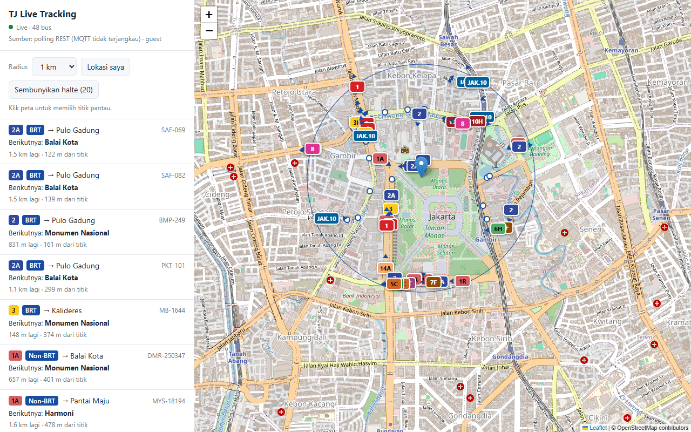

# Testing

Ada dua jenis pengujian: test otomatis yang tidak butuh internet, dan uji live ke server TransJakarta dengan browser sungguhan.

## Test otomatis

```powershell
.\.venv\Scripts\python -m pytest -q
```

```
....................                                                     [100%]
20 passed, 1 warning in 0.98s
```

Peringatan `StarletteDeprecationWarning` tentang `httpx2` berasal dari `TestClient` Starlette dan tidak memengaruhi hasil.

### Cara kerjanya

Semua test ada di `tests/test_api.py`.

- **`FakeTJ`** meniru `tijeapi` lewat `httpx.MockTransport`. Ia menerbitkan token (`tok1`, `tok2`, …), menolak request tanpa token valid dengan 401 seperti server asli, dan menyediakan `/v1/auth/login/guest`, `/v1/auth/login` (hanya menerima `me@example.com` / `s3cret`), `/v1/auth/token/refresh`, `/v1/bus/offline`, `/v2/bus-stop`, dan `/v1/user/trips`. Isi `/v1/bus/offline` diatur lewat `fake.offline_buses` dan kode statusnya lewat `fake.offline_status`, jadi test bisa "menggerakkan" bus di tengah jalan. Semua request yang diterima dicatat di `fake.calls`.
- **`client`** (fixture) membuat aplikasi lengkap lewat `create_app` dan membungkusnya dengan `fastapi.testclient.TestClient`, jadi lifespan, routing, validasi, WebSocket, dan `_poll_loop` ikut dites. Fixture memakai `poll_seconds=0.05` supaya test WebSocket cepat.
- **`Settings(_env_file=None, ...)`** dipakai di semua test, jadi file `.env` lokal (misalnya berisi akun pribadi) tidak ikut terbaca dan tidak mengubah hasil test.
- **`wait_for(ws, cond)`** membaca `snapshot` berturut-turut sampai ada yang memenuhi syarat. Karena `snapshot` dikirim terus dengan jadwal tetap, test tidak bergantung pada waktu yang pas.

### Daftar test

| Test | Yang dipastikan |
|---|---|
| `test_buses_polls_area_and_returns_nearby` | Urutan request upstream (login guest → `/v1/bus/offline`), body `/v1/bus/offline`, header identitas, Bearer token, hanya bus dalam radius yang dikembalikan, jenis `brt` menjadi `BRT`, `source` = `rest:/v1/bus/offline` |
| `test_buses_reuses_recent_poll` | Dengan `poll_seconds=60`, tiga `/buses` berturut-turut hanya memicu satu `/v1/bus/offline` |
| `test_token_is_reused` | Token dipakai ulang untuk tiga `/stops` berturut-turut |
| `test_relogin_after_401` | Token dicabut server → backend login ulang sekali dan request berhasil dengan `tok2` |
| `test_expired_token_is_refreshed` | Token yang hampir habis diperbarui lewat `/v1/auth/token/refresh` dengan `refresh_token` yang benar |
| `test_static_bearer_token_skips_guest_login` | `TJ_BEARER_TOKEN` dipakai langsung tanpa login |
| `test_snapped_position_and_out_of_order_updates` | Posisi `snap_*` diutamakan; update dengan timestamp lebih lama diabaikan |
| `test_bus_not_found_and_bad_payload` | Item yang bukan objek bus diabaikan oleh `ingest`; bus tak dikenal → 404 |
| `test_validation_and_upstream_errors` | Koordinat London → 422; upstream 500 → 502 di `/buses/offline` dan `/buses`; WebSocket menerima pesan `error` |
| `test_radius_capped_at_max` | Radius 50 dipotong ke 20, dan upstream hanya menerima radius 20 |
| `test_route_filter` | `routes= 4, 4d ` hanya mengembalikan jalur 4 dan 4D; `routes_available` urut alami dengan jumlah benar |
| `test_websocket_route_filter` | WebSocket dengan `routes=4D,4` hanya mengirim jalur itu, tidak peka huruf besar-kecil, termasuk bus yang baru muncul di polling berikutnya |
| `test_websocket_sends_snapshot_every_interval` | WebSocket mengirim `snapshot` berulang sesuai `poll_seconds` (tidak beruntun tanpa jeda), hanya bus dalam radius dengan `distance_km`; bus yang bergerak, baru muncul, atau keluar radius terlihat di `snapshot` berikutnya; `ws_clients` kembali 0 setelah client putus |
| `test_stops_passthrough` | `/stops` meneruskan `data` dari `/v2/bus-stop` |
| `test_poll_fields` | `/buses` berisi data `/v1/bus/offline`; `next_stop_name`, `prev_stop_name`, `trip_headsign`, dan `source` benar |
| `test_account_login_used_and_trips_available` | Login akun dipakai, `/account/trips` 200, `/account` menunjukkan `user`, password tidak muncul di `/health` |
| `test_wrong_password_falls_back_to_guest` | Password salah → guest, `last_error` terisi, `/account/trips` 403, password tidak bocor |
| `test_trips_need_account` | Mode guest → `/account/trips` 403 |
| `test_ui_is_served` | `/` mengarah ke UI dan halaman memuat kode WebSocket |
| `test_health` | `/health` berisi status, auth guest, dan `tracker` = `{"buses": 0, "areas": 0, "ws_clients": 0, "poll_seconds": 0.05}` |

### Menjalankan sebagian

```powershell
.\.venv\Scripts\python -m pytest -q -k account        # hanya test yang namanya mengandung "account"
.\.venv\Scripts\python -m pytest -q -x                # berhenti di kegagalan pertama
.\.venv\Scripts\python -m pytest -vv tests/test_api.py::test_relogin_after_401
```

## Uji live dengan Playwright

Uji ini membuka UI di Microsoft Edge tanpa jendela, membiarkan backend bicara dengan server TransJakarta asli, lalu memeriksa hasilnya. Uji ini mengirim request sungguhan ke upstream, jadi jalankan seperlunya.

### Persiapan

Playwright tidak dipasang di venv proyek. Uji yang dipakai selama pengembangan memanfaatkan `playwright-core` yang sudah ikut terpasang bersama paket npm global `rea-agents`, dan Microsoft Edge yang ada di Windows (`channel: "msedge"`, jadi tidak perlu mengunduh browser Playwright).

Cara yang paling mudah diulang adalah memasang `playwright-core` di folder terpisah. Paket npm global tidak bisa di-`import` dari modul ES, jadi pasang secara lokal:

```powershell
mkdir $env:TEMP\tj-e2e; cd $env:TEMP\tj-e2e
npm init -y
npm install playwright-core@1.58.2
```

### Skrip

Simpan sebagai `live_e2e.mjs` di folder `tj-e2e` tadi:

```js
import { chromium } from "playwright-core";

const base = "http://127.0.0.1:8770";
const browser = await chromium.launch({ channel: "msedge", headless: true });
const page = await browser.newPage({ viewport: { width: 1280, height: 800 } });

const errors = [];
const frames = [];
page.on("pageerror", (e) => errors.push(e.message));
page.on("console", (m) => m.type() === "error" && errors.push(m.text()));
page.on("websocket", (ws) => ws.on("framereceived", (f) => frames.push(String(f.payload))));

await page.goto(base + "/", { waitUntil: "networkidle" });
await page.mouse.click(780, 330);                       // pilih titik di dekat koridor 1
await page.waitForSelector(".bus", { timeout: 60000 }); // tunggu bus pertama
await page.waitForTimeout(25000);                       // beri waktu untuk beberapa polling

console.log("status :", await page.textContent("#status"));
console.log("sumber :", await page.textContent("#source"));
console.log("daftar :", await page.locator(".bus").count(), "bus");
console.log("marker :", await page.locator(".bus-icon").count());
console.log("frame WS:", frames.length);
console.log("error  :", errors);

await page.click("#stopsBtn");
await page.waitForTimeout(3000);
console.log("halte  :", await page.textContent("#stopsBtn"));
await page.screenshot({ path: "live.png" });

const health = await (await fetch(base + "/health")).json();
console.log("health :", health.auth.logged_in_as, health.tracker);
await browser.close();
```

### Menjalankan

Terminal pertama, server di port terpisah supaya tidak bentrok dengan server yang sedang dipakai:

```powershell
.\.venv\Scripts\python -m uvicorn app.main:app --port 8770
```

Terminal kedua:

```powershell
node live_e2e.mjs
```

### Hasil yang diharapkan

- `status` berbentuk `Live · <jumlah> bus`, dan `daftar` serta `marker` sama dengan jumlah itu (daftar dibatasi 200 bus).
- `sumber` berbentuk `Sumber: polling REST tiap 1 dtk · guest`.
- `frame WS` kira-kira satu per detik selama halaman terbuka, karena setiap frame adalah satu `snapshot`.
- `error` kosong, dan `halte` berbentuk `Sembunyikan halte (<jumlah>)` (paling banyak 20).
- `health` menunjukkan `guest` dan objek `tracker` dengan `ws_clients: 1` dan `poll_seconds: 1`. `areas` bisa 2 karena area Monas dari titik awal masih diingat sampai 60 detik setelah ditinggalkan.

Request ke upstream selama uji (dari log server): satu `POST /v1/auth/login/guest`, sekitar satu `POST /v1/bus/offline` per detik untuk area yang sedang dibuka, dan satu `GET /v2/bus-stop` saat halte ditampilkan.



## Uji tampilan tanpa upstream

Untuk mengubah UI tanpa menyentuh server TransJakarta, jalankan aplikasi dengan upstream palsu dan bus simulasi. Upstream palsu di bawah menghitung posisi tiga bus dari jam saat ini setiap kali `/v1/bus/offline` dipanggil, jadi bus terlihat bergerak tanpa thread tambahan. Contoh skrip demo:

```python
"""Demo: aplikasi asli + upstream palsu + tiga bus berputar di sekitar Monas."""

import math, time
import httpx, uvicorn
from app.config import Settings
from app.main import create_app
from app.upstream import TJClient

ROUTES = [
    ("TJ-0101", "1", "D32F2F"),
    ("TJ-0205", "2", "1565C0"),
    ("MK-1001", "JAK.10", "F9A825"),
]


def buses_now():
    t = time.time()
    out = []
    for i, (no, route, color) in enumerate(ROUTES):
        a = t / 20 + i * 2
        out.append(
            {
                "bus_body_no": no,
                "route_code": route,
                "route_color": color,
                "route_text_color": "FFFFFF",
                "latitude": -6.1754 + 0.004 * math.sin(a),
                "longitude": 106.8272 + 0.005 * math.cos(a),
                "bearing": (math.degrees(-a) + 360) % 360,
                "timestamp": int(t),
                "type": "brt",
                "next_stops": "H00001P-Monas",
            }
        )
    return out


def upstream(req):
    if req.url.path == "/v1/auth/login/guest":
        return httpx.Response(
            200, json={"token": "demo", "token_valid_until": time.time() + 86400}
        )
    if req.url.path == "/v1/bus/offline":
        return httpx.Response(200, json={"data": buses_now()})
    if req.url.path == "/v2/bus-stop":
        return httpx.Response(
            200,
            json={
                "data": [
                    {
                        "stop_id": "1",
                        "stop_name": "Monas",
                        "stop_lat": -6.1767,
                        "stop_lon": 106.8230,
                        "bus_stop_type": "halte",
                    }
                ]
            },
        )
    return httpx.Response(404)


s = Settings(_env_file=None, bearer_token="")
app = create_app(s, client=TJClient(s, transport=httpx.MockTransport(upstream)))

if __name__ == "__main__":
    uvicorn.run(app, host="127.0.0.1", port=8766)
```

Simpan sebagai `demo_server.py` **di dalam folder `python`** (sejajar dengan folder `app`), karena Python mencari paket `app` relatif terhadap lokasi skrip. Lalu:

```powershell
.\.venv\Scripts\python demo_server.py
```

Buka http://127.0.0.1:8766/. `GET /buses?lat=-6.1754&lon=106.8272` akan berisi tiga bus simulasi (`TJ-0101`, `TJ-0205`, `MK-1001`). Kalau skrip disimpan di tempat lain, jalankan dengan `$env:PYTHONPATH = "<path ke folder python>"` lebih dulu.
