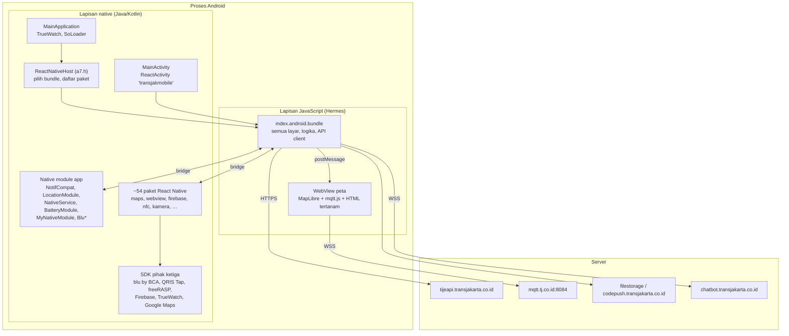

# Arsitektur aplikasi

## Lapisan



Hampir semua fitur hidup di JavaScript. Kode Java milik TransJakarta sendiri hanya 12 kelas di `com.transjakmobile`, dan sebagian besar hanya penghubung ke SDK atau API Android. Itu sebabnya endpoint, payload, dan alur bisnis harus dicari di bundle Hermes, bukan di smali atau Java.

## React Native

| Hal | Nilai |
|---|---|
| Arsitektur | Lama (bridge). `IS_NEW_ARCHITECTURE_ENABLED = false`, `isNewArchEnabled()` mengembalikan `false` |
| Mesin JavaScript | Hermes (`libhermes.so`), bytecode versi 96 |
| Nama komponen root | `transjakmobile` (`MainActivity.getMainComponentName()`) |
| Modul utama JS | `index` (`getJSMainModuleName()`) |
| Developer support | Mati (`getUseDeveloperSupport()` → `false`) |
| Daftar paket | `PackageList` (paket dari `node_modules`) ditambah tiga paket internal `B7.b(16)`, `B7.b(15)`, `B7.b(28)` yang mendaftarkan native module milik app |

## Bundle JavaScript dan pembaruan OTA

App bisa mengganti bundle JavaScript tanpa update dari Play Store. Logikanya ada di `a7.h.getJSBundleFile()` (file `A7/h.java` di hasil JADX):

```java
public final String getJSBundleFile() {
    File file = new File(mainApplication.getFilesDir(), "index.android");
    File file2 = new File(mainApplication.getFilesDir(), "versionAndroid.json");
    if (file2.exists()) {
        TrackLog.d("ReactNative", "Current bundle version: " + S7.a.c(file2));
    }
    if (file.exists()) {
        return file.getAbsolutePath();
    }
    return super.getJSBundleFile();   // assets/index.android.bundle
}
```

Urutannya:

1. Kalau `files/index.android` ada di penyimpanan internal app, bundle itu yang dipakai.
2. Kalau tidak, app memakai `assets/index.android.bundle` bawaan APK.
3. `files/versionAndroid.json` menyimpan versi bundle OTA dan hanya dipakai untuk log.

Setelah bundle baru diunduh, JavaScript memanggil `MyNativeModule.reloadBundle(path)`. Method ini membuka ulang activity utama dengan `Intent.makeRestartActivityTask` lalu mematikan proses (`Runtime.getRuntime().exit(0)`), jadi app hidup lagi dengan bundle baru.

Host yang kemungkinan dipakai untuk OTA dan aset dinamis: `codepush.transjakarta.co.id` (41 rujukan di bundle, kebanyakan gambar di `/tjapps/images/`) dan `filestorage.transjakarta.co.id/bundle-tjapp/` (`cdn/`, `assets/`, `assets/markdown/`). URL unduhan bundle OTA tidak ditemukan sebagai string utuh, kemungkinan disusun saat runtime dari konfigurasi server.

Akibatnya, **perilaku app di perangkat pengguna bisa berbeda dari bundle di APK ini** kalau sudah ada pembaruan OTA. Dokumentasi ini menjelaskan bundle bawaan APK 3.0.4.

## Environment

Bundle mengenal tiga server backend:

| Nama | Base URL |
|---|---|
| prod | `https://tijeapi.transjakarta.co.id` |
| staging | `https://stg-tijeapi.transjakarta.co.id` |
| development | `https://tije-api-dev.transjakarta.co.id` |

State store utama menyimpan `'api': 'prod'` sebagai nilai awal. `BuildConfig.BASE_URL` juga menunjuk ke prod.

SDK blu by BCA Digital punya environment sendiri yang dipilih dari parameter `env` saat `BluActivity` dibuka: `"prod"` memakai `ENV_PROD` (`https://page.blubybcadigital.id/blupay`), nilai lain memakai `ENV_UAT` (`https://mdigi.umundus.net/blupay`). Lihat [05-library-dan-sdk.md](05-library-dan-sdk.md#blu-by-bca-digital).

## Server dan layanan yang dihubungi

| Host | Dipakai untuk |
|---|---|
| `tijeapi.transjakarta.co.id` | API utama: akun, rute, halte, bus, tiket, pembayaran, laporan |
| `mqtt.tj.co.id:8084` | Posisi bus realtime (MQTT over WebSocket, alamat didapat dari API) |
| `chatbot.transjakarta.co.id` | Chatbot layanan pelanggan (WebSocket) |
| `codepush.transjakarta.co.id` | Gambar, halaman syarat dan ketentuan, kemungkinan bundle OTA |
| `filestorage.transjakarta.co.id` | Aset dinamis, gambar cuaca, kampanye, markdown syarat Royaltrans |
| `ppid.transjakarta.co.id` | Halaman PPID (informasi publik) |
| `api.maptiler.com`, `basemaps.cartocdn.com`, `tiles.basemaps.cartocdn.com` | Gaya dan tile peta di WebView |
| `api.mapbox.com` | Lapisan lalu lintas (`mapbox.mapbox-traffic-v1`) |
| Google Maps (`com.google.android.geo.API_KEY`) | Peta native `react-native-maps` |
| `api.open-meteo.com`, `openweathermap.org` | Cuaca di beranda |
| `id1-rum-openway.truewatch.com` | Telemetri TrueWatch (RUM) |
| Firebase | Push notification, analitik, crashlytics, remote config |
| `*.blubybcadigital.id`, `mdigi.umundus.net` | Pembayaran blu by BCA Digital |
| `tjpay-faq.web.app` | Halaman FAQ dan syarat Royaltrans |
| `audio-edge-jfbmv.sin.d.radiomast.io` | Streaming audio (kemungkinan radio di app, lewat `react-native-track-player`) |

## Fitur utama (dari nama layar dan endpoint)

| Fitur | Bukti |
|---|---|
| Peta, bus terdekat, halte terdekat | `getBusNearest`, `getSearchBusStopNew`, WebView MapLibre |
| Live tracking perjalanan dan notifikasi tujuan | `NotifCompat`, `react-native-background-actions`, string `Start Tracking Location 10 minutes` |
| Perencana perjalanan | `postTripPoint` (`/v1/direction`), kampanye `TripPlannerStep4` |
| Info rute dan pengalihan rute | `/v1/route`, `/v2/route`, `/v1/route-diversion` |
| Tiket reguler, TJ Pass, Royaltrans, Open Top Tour | `/v1/ticket/*`, `/v2/ticket/*`, `/v3/ticket/*`, `/v1/subscription/*` |
| Pembayaran | blu by BCA, AstraPay, Bayarind (termasuk QRIS Tap NFC), VA Bank DKI |
| Laporan dan keluhan | `/v2/reports/*` |
| Rating layanan | `/v1/ratings` |
| Feed, mengikuti rute | `/v1/tweet/following`, `/v1/user/feed/*` |
| Loyalti dan pencapaian | `/v1/loyalty-tije/...`, `/v1/user/achievements` |
| MoTer (kemungkinan program mitra/hadiah) | `/v1/moter/*` |
| Chatbot | `CHATBOT_URL` |
| Ganti ikon app (HUT RI, Natal) | Activity alias `MainActivityAppIconHutRi`, `MainActivityAppIconNatal`, `react-native-change-icon` |
