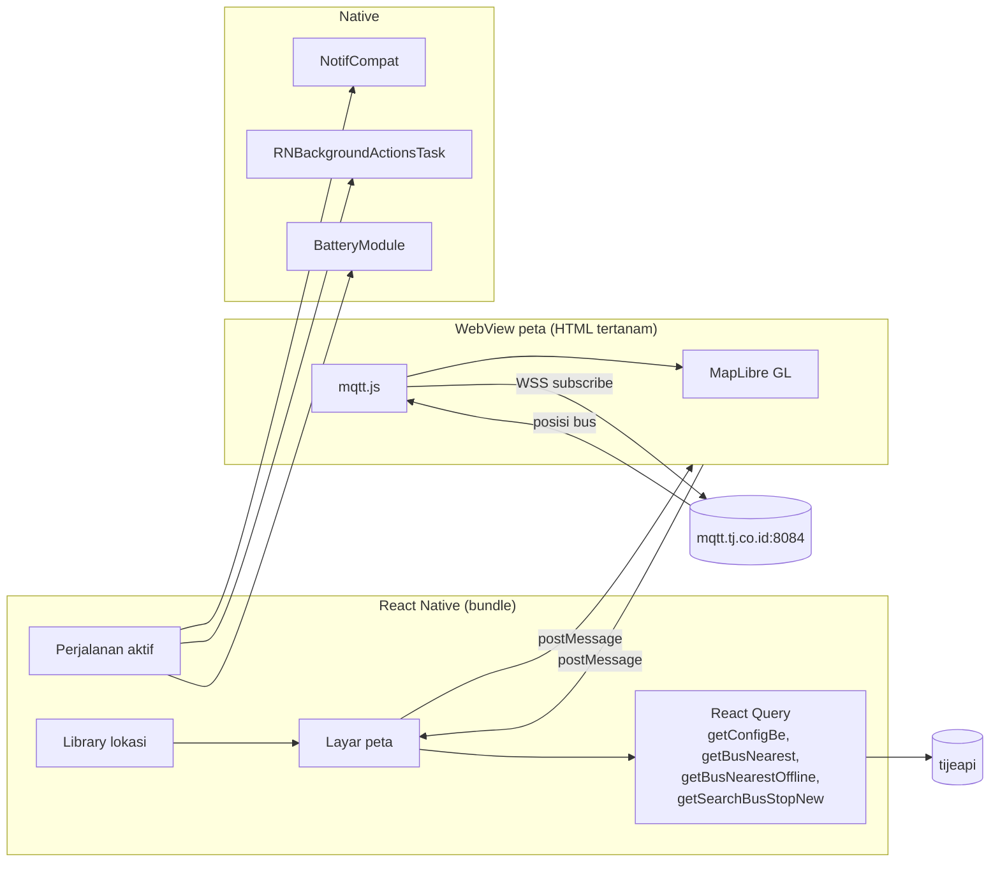
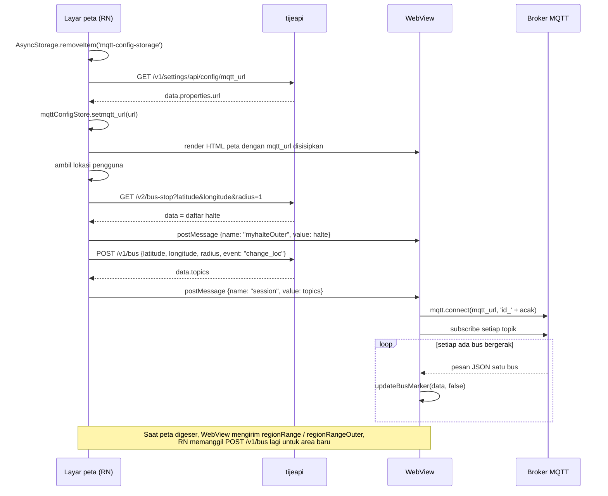

# Live tracking di app

"Live tracking" di app TransJakarta sebenarnya dua fitur:

1. **Peta bus live**: marker bus bergerak di peta sekitar pengguna. Datanya dari MQTT.
2. **Perjalanan aktif**: saat pengguna sedang naik bus, app menampilkan notifikasi menempel berisi tujuan dan perkiraan tiba, dan bisa terus memantau lokasi di latar.

## Gambaran besar



## 1. Peta bus live

### Urutan saat layar peta dibuka



Kalau `GET /v2/bus-stop` mengembalikan daftar kosong, app menampilkan toast "Location Out of Service Area".

### Body `POST /v1/bus` di app

Ada dua bentuk pemanggilan di kode layar peta (direkonstruksi dari hasil decompile, nama variabel dibuat ulang):

```js
// saat lokasi pengguna didapat
getBusNearest({ altenativePayload: { latitude, longitude, radius, event: "change_loc" } });

// juga dipakai untuk halte di sekitar
getSearchBusStopNew({ altenativeparams: { latitude, longitude, radius: 1 } });
```

Response `data.topics` langsung diteruskan ke WebView:

```js
onSuccess(res) {
  webviewRef.current?.postMessage(JSON.stringify({ name: "session", value: res.data.topics }));
}
```

### Koneksi MQTT di WebView

Potongan HTML yang tertanam di bundle (teks asli, komentar dihapus):

```js
var client;
async function fetchDataAndConnectMQTT(session) {
  try {
    if (client) {
      client.end();
      console.log('Previous MQTT client disconnected');
    }
    client = mqtt.connect(
      '<mqtt_url>',
      'id_' + parseInt(Math.random() * 100000),
    );

    client.on('connect', function () {
      console.log('Connected to MQTT broker');
      // indikator hijau, cek jarak dari pusat peta, dst.
      const topics = session;
      topics.forEach(topic => {
        client.subscribe(topic, (err) => {
          if (err) console.log('Failed to subscribe to' + topic + '', err);
          else     console.log('Subscribed to ' + topic + '');
        });
      });
    });

    client.on('message', function (topic, message) {
      const data = JSON.parse(message.toString());
      updateBusMarker(data, false);
      updateIndicatorBus(/* warna indikator */);
    });
  } catch (e) { /* ... */ }
}
```

Hal yang bisa dipelajari dari kode ini:

| Hal | Nilai |
|---|---|
| URL broker | dari `GET /v1/settings/api/config/mqtt_url`, saat ini `wss://mqtt.tj.co.id:8084/mqtt` |
| Client ID | `id_` + angka acak 0–99999 |
| Username/password | tidak ada |
| Argumen kedua `mqtt.connect` | string, bukan objek opsi. mqtt.js tetap memakai opsi bawaan (MQTT 3.1.1, keepalive 60, clean session) |
| Topik | dari `POST /v1/bus`, pola `/mobile_armada/<baris>-<kolom>/#` |
| QoS | bawaan `subscribe` mqtt.js (0) |
| Isi pesan | JSON satu bus |

### Isi pesan MQTT

Field yang dibaca `updateBusMarker`:

```js
const { bus_body_no, snap_latitude, latitude, snap_longitude, longitude, bearing, timestamp,
        route_code, route_color, route_text_color, next_stops, estimated_time_next_stops, type } = data;
```

Contoh bentuk pesan (disusun dari field di atas; isi pesan MQTT asli belum pernah diterima karena broker tidak terjangkau dari jaringan pengembang):

```json
{
  "bus_body_no": "MYS-17022",
  "latitude": -6.19545,
  "longitude": 106.823278,
  "snap_latitude": -6.195461,
  "snap_longitude": 106.823301,
  "bearing": 217,
  "timestamp": 1791900000,
  "route_code": "1",
  "route_color": "D62126",
  "route_text_color": "FFFFFF",
  "next_stops": "H00278P-Harmoni",
  "estimated_time_next_stops": 0,
  "type": "BRT"
}
```

### Aturan marker di WebView

- Posisi yang dipakai: `snap_*` kalau ada, kalau tidak `latitude`/`longitude`.
- Marker yang sudah ada hanya diperbarui kalau `timestamp` baru lebih besar dari yang tersimpan (`allMarkers[no].timestamp < timestamp`). Perpindahan dianimasikan (`animateMarker`).
- Jenis: `BRT` kalau `type` = BRT, `Mikrotrans` kalau MIKROTRANS, selain itu `Non-BRT`.
- Popup menampilkan kode rute dengan warna rute, jenis, label khusus (misalnya bus pink), nomor bus, "halte berikutnya", nama halte, dan perkiraan waktu, ditambah tombol "Lapor" dan "Detail".
- `removeExpiredMarkers()` menghapus marker yang tidak diperbarui lebih dari 5 menit atau yang keluar dari lingkaran area. Pemanggilan berkalanya (`setInterval`) di-comment di kode, jadi kemungkinan tidak aktif.

Backend Python memakai aturan yang sama untuk posisi, urutan timestamp, jenis, dan masa simpan 5 menit.

### Pesan antara React Native dan WebView

Dari RN ke WebView (`message.name`):

| Nama | Isi `value` | Efek |
|---|---|---|
| `session` | daftar topik | Sambung ke broker dan subscribe |
| `disconnetMqtt` | | Putuskan MQTT, hapus semua marker bus (ejaan asli) |
| `myhalte` | daftar halte | Perbarui marker halte |
| `myhalteOuter` | daftar halte | Perbarui sumber GeoJSON halte (`bus-stops`, `bus-stops2`) dengan animasi pegas untuk halte baru |
| `mylocation` | `{latitude, longitude, bearing}` | Pindahkan marker posisi pengguna |
| `mylocation_companion` | posisi | Terbang ke posisi "companion", kemungkinan fitur berbagi perjalanan |
| `flytoStart` | posisi | Terbang ke titik awal |
| `filter` | `{nameHalte: {halte, bus_stop}, …}` | Tampilkan atau sembunyikan jenis marker |
| `polyline` | data jalur | Gambar jalur rute |
| `rotateNorth` | | Putar peta ke utara |
| `changeIndicator` | `{color, text}` | Ubah indikator status |
| `screenshot` | | Ambil gambar peta dengan html2canvas |

Dari WebView ke RN:

| Nama | Isi | Arti |
|---|---|---|
| `compass` | sudut | Peta diputar (`map.on("rotate")`) |
| `indicator` | `{color}` | Status koneksi bus (hijau/abu) |
| `halteAvail` | daftar halte | Halte yang tampil |
| `regionRange`, `regionRangeOuter` | area peta | Peta digeser, RN memanggil `POST /v1/bus` dan `GET /v2/bus-stop` lagi |
| `konek` | `{tes: radiusInKm}` | Debug saat terhubung |
| `screenshot` | base64 PNG | Hasil `screenshot` |
| klik halte | data halte | RN membuka layar `DetailHalte` |

### Peta dan tile

WebView memakai MapLibre GL dengan gaya dari MapTiler (`api.maptiler.com/maps/c0e27dd8-…/style.json`) atau Carto (`basemaps.cartocdn.com/gl/positron-gl-style`), dan lapisan lalu lintas Mapbox (`mapbox.mapbox-traffic-v1`). Teks label memakai `Open Sans Semibold`.

## 2. Perjalanan aktif

### Notifikasi

Saat perjalanan aktif, JavaScript memanggil:

```js
NativeModules.NotifCompat.showNotification(tujuan, estimasi, jumlah);
```

Hasilnya notifikasi menempel (ID 1001) dengan judul `Tujuan <tujuan>` dan teks `Estimasi tiba <estimasi>`. Setiap panggilan memperbarui notifikasi yang sama. Detail tampilannya di [04-kode-native.md](04-kode-native.md#notifcompat).

### Pemantauan di latar

| Komponen | Peran |
|---|---|
| `react-native-background-actions` (`RNBackgroundActionsTask`, `foregroundServiceType=location`) | Menjalankan loop JavaScript selama perjalanan dengan notifikasi foreground (channel `RN_BACKGROUND_ACTIONS_CHANNEL`, judul `taskTitle`, deskripsi `taskDesc`, opsional progress bar) |
| `ACCESS_BACKGROUND_LOCATION`, `FOREGROUND_SERVICE_LOCATION` | Izin lokasi saat app di latar |
| `BatteryModule` | Meminta pengecualian optimasi baterai supaya tugas tidak dimatikan |
| String `Start Tracking Location 10 minutes` | Opsi tracking berbatas 10 menit |
| `/v1/user/achievements/trip` (`submitTripAchievement`) | Mencatat perjalanan selesai untuk pencapaian |
| `/v1/user/trips` (`getTrips`), `/v1/user/trips/{id}` (`getTripById`) | Riwayat perjalanan |

Service HeadlessJS milik app (`a7.a`) tidak dideklarasikan di manifest, jadi yang benar-benar menjalankan tugas latar adalah `RNBackgroundActionsTask`.

## 3. Yang ditiru backend Python

| Bagian app | Padanan di backend |
|---|---|
| `GET /v1/settings/api/config/mqtt_url` | `TJClient.get_mqtt_url()` |
| `POST /v1/bus` → `topics` | `TJClient.get_area()` |
| `mqtt.connect(url, 'id_' + acak)` + subscribe | `Tracker.start()`, `Tracker.want_topics()` |
| `updateBusMarker` (snap, urutan timestamp, jenis) | `Tracker.ingest()`, `bus_position()`, `bus_type()` |
| `removeExpiredMarkers` (5 menit) | `Tracker.prune()` dengan `TJ_BUS_EXPIRY_SECONDS=300` |
| `GET /v2/bus-stop` | `GET /stops` |
| marker offline dari `/v1/bus/offline` | polling REST saat MQTT tidak terjangkau |
| Login guest | mode `guest` |

Perbedaannya: backend membuka satu koneksi MQTT untuk banyak client, dan mem-polling `POST /v1/bus/offline` secara berkala kalau broker tidak terjangkau. App asli mengandalkan MQTT untuk gerakan live; `/v1/bus/offline` di app kemungkinan hanya dipanggil saat area berubah, bukan berkala.
